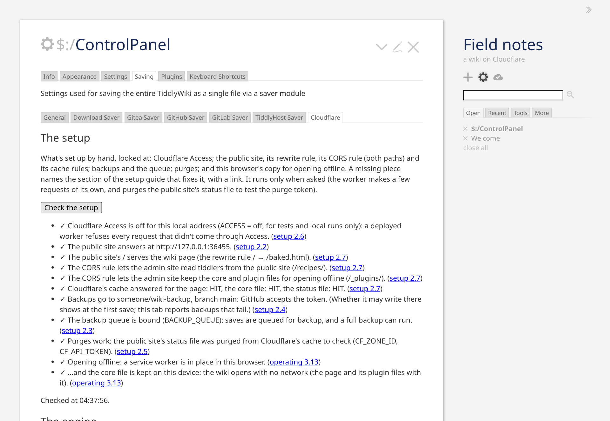
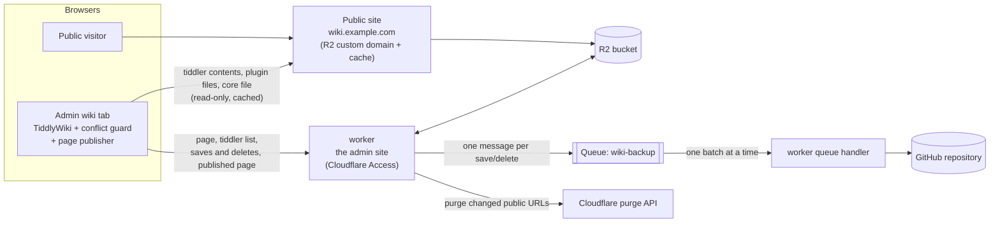

# TiddlyWiki on Cloudflare

  

Host your own [TiddlyWiki](https://tiddlywiki.com) on Cloudflare's free plan: a worker for editing, R2 for storage, a public read-only site served from the cache if you want one, and every save backed up to GitHub as its own commit.

- **The admin wiki,** at the worker's own address (`https://wiki-admin.<your subdomain>.workers.dev`, or a custom domain such as `admin.wiki.example.com`), is yours to edit, behind Cloudflare Access. A Cloudflare Worker speaks TiddlyWiki's own sync protocol (TiddlyWeb) and stores every tiddler in an R2 bucket.
- **The public wiki,** `https://wiki.example.com`, if you want one, is the same bucket served directly through its custom domain and Cloudflare's cache: read-only, and no worker involved, so visitors cost no worker requests. Without it, the wiki is private.

What the worker adds to a plain TiddlyWeb server:
- **Edit-conflict protection:** two tabs or devices editing the same tiddler can't silently overwrite each other; the later one gets a conflict copy and an alert.
- **A public copy that stays fresh:** after each change, exactly the cached URLs that changed are purged.
- **Plugins installed from the wiki work on both sites:** each gets its own file, which the page loads before TiddlyWiki starts.
- **A page TiddlyWiki writes itself:** the admin wiki renders the page with TiddlyWiki's own template and publishes it, so the title, the language and `$:/tags/RawMarkup…` tiddlers (link previews, a splash screen) work as in a single-file wiki. The core is a separate file cached for a year, which makes the page about 300 KB instead of 2.8 MB.
- **As few worker requests as it can:** a page load is 2 requests, tiddler contents come from the public site, and background tabs stop polling.
- **Backups through a Cloudflare Queue:** one commit per save, retried through outages and rate limits, with an alert in the admin wiki if they keep failing.

A new wiki starts by itself: the first time you open the admin site, the worker puts an empty TiddlyWiki in the bucket. To move an existing wiki in, drag its file onto the admin wiki.

**Private, or public.** Without a public site, the wiki is private: the admin site is the only one, behind Cloudflare Access, at the worker's own `workers.dev` address — no domain needed, and nothing in the bucket is reachable by anyone else. With a public site (the bucket's custom domain, one setting), every tiddler you save is readable there by anyone the moment it's saved (drafts are never saved, so they aren't): for a wiki you publish — a blog, documentation, notes you share. A private wiki can be made public later by adding that one setting; nothing moves.

## Quick start

**What you need:** a Cloudflare account (the free plan is enough) and a GitHub account (the worker is deployed from your copy of this repository; the backup goes to a repository too). For a public site, also a domain on that account (both sites are then hostnames of it).

About ten minutes, in this order, and the button does half of it. The setup guide, [chapter 2](docs/setup.md), has each step in full, and the wiki's own setup check (the last step) names the section for anything missing.

**With the button,** Cloudflare copies the repository into your GitHub account, creates the bucket and the queue, and builds and deploys the worker — steps 1, 2, 3 and 5 below, with a switch for Access (6) to check afterwards — then you open the wiki (8). The settings and the two secrets, all optional, go in the dashboard afterwards (5); for a public site, the domain (2) and the zone's rules (7) are by hand either way ([setup 2.1](docs/setup.md#21-before-you-start)). The eight steps:

1. **Make your copy of this repository** — a fork, a copy from the template, or the button's copy ([setup 2.1](docs/setup.md#21-before-you-start)). Nothing in it is edited: the worker is deployed as it is, and your settings go in the dashboard.
2. **The bucket,** `wiki`, in R2; for a public site, its custom domain ([setup 2.2](docs/setup.md#22-the-bucket-and-the-public-site)).
3. **The queue,** `wiki-backup` ([setup 2.3](docs/setup.md#23-the-backup-queue)).
4. **A backup repository and a token for it,** if you want every save committed to GitHub ([setup 2.4](docs/setup.md#24-the-backup-repository-optional), optional).
5. **The worker,** `wiki-admin`, built from your copy by Workers Builds, with the settings and the two secrets in its dashboard ([setup 2.5](docs/setup.md#25-the-worker)).
6. **Cloudflare Access** in front of it ([setup 2.6](docs/setup.md#26-cloudflare-access)).
7. **The zone's rules** — the rewrite, the cache rules, the CORS header — for a public site only ([setup 2.7](docs/setup.md#27-the-zones-rules-public-site-only)).
8. **Open the admin site:** the wiki starts by itself, and *Check the setup* in its Cloudflare tab tells you what's missing ([setup 2.8](docs/setup.md#28-the-first-visit)).

*The admin wiki: TiddlyWiki as it is, with the Cloudflare tab the worker adds, after Check the setup. Taken from the test setup by the screenshot tool, so the addresses are local ones.*

**Status:** in use for the author's own wiki. Versions are dated, the newest at the top of [the changelog](CHANGELOG.md), and the admin wiki shows which one it runs. Every change goes through the test suites of [chapter 6](docs/development.md), which run a real TiddlyWiki against the real worker and measure what each request costs on the free plan.

**Written with Claude.** The code, the tests and the manual were written by Claude Code, from the author's requirements and constraints — the free plan's limits, the edge cases to handle, what a user should see — under the process of [CONTRIBUTING.md](CONTRIBUTING.md): a plan in the user's words, tests seen failing first, every suite, the docs in the same pull request. No human has read it line by line; what stands for review is that process, the suites of [chapter 6](docs/development.md), and the author's daily use. Read [SECURITY.md](SECURITY.md#what-the-design-counts-on), "What the design counts on", before trusting it with anything that matters.

---

## The manual

Seven chapters, numbered across the pages: a section number means the same thing wherever it's cited, in these pages, in the worker's own messages and in the code. Chapter 1 is below; the rest are pages under `docs/`.

1. [How it fits together](#1-how-it-fits-together): the pieces, and the names used throughout
2. [Setting up](docs/setup.md): the bucket, the queue, the backup repository, the worker, Access, the zone's rules, the first visit
3. [Operating it](docs/operating.md): updates, plugins, backups, logs, working offline, conflicts, the app, the settings
4. [Troubleshooting](docs/troubleshooting.md): symptoms, causes and fixes
5. [Known limits](docs/limits.md): what you can hit, and what to do about it
6. [Development and tests](docs/development.md): the build, the suites, the repository layout
7. [Reference](docs/reference.md): the Cloudflare, GitHub and TiddlyWiki documents the design relies on

How the worker works, and why it's built this way: [docs/design.md](docs/design.md). What each test suite covers: [docs/tests.md](docs/tests.md). Where it's going: [docs/roadmap.md](docs/roadmap.md).

---

## 1. How it fits together

| Piece | Role |
|---|---|
| **The worker** (`worker.js`, built from `src/worker/`) | Serves the admin wiki: the page, the TiddlyWeb endpoints, saves and deletes with their conflict checks, cache purges. Writes a file for each plugin, and consumes the backup queue. |
| **Browser modules** (`src/browser/`) | TiddlyWiki modules the worker builds into the page. The conflict guard makes the browser say which version each edit is based on, handles conflicts, and sends saves in the layout the worker stores; the list sync keeps the tiddler list, loads what's shown first and keeps loaded tiddlers on the device, reads from the public site and cuts unneeded requests; the backup alert shows backups that keep failing; the page publisher, in the admin wiki, renders the page with TiddlyWiki's own template and sends it to the worker whenever it changes; the restore import turns the backup's files, dropped onto the wiki, back into tiddlers; the control panel's Cloudflare tab shows how backups go and starts a full backup; the outbox keeps every change on the device until the worker has it, so editing offline loses nothing, and hands the browser's other tabs what it saved and the draft being typed, so they follow each other; the cold start registers a service worker, so the wiki opens with no network; the device tab measures what this browser keeps of the wiki, asks it to keep that, or forgets it. |
| **R2 bucket** | Holds everything: the wiki engine (`index.html`), the page both sites serve, the tiddler list, one JSON file per tiddler, one script per plugin, and TiddlyWiki's core file. |
| **Public site** | The bucket's custom domain. Cloudflare caches it, and nothing on it runs the worker. A private wiki has none: the worker serves the tiddler contents, the plugin files and the core file itself, and the device copy keeps a reload from asking for them again. |
| **Queue** `wiki-backup` | Holds one message per save or delete until it has been committed to GitHub. |
| **GitHub repository** | Version history: one commit per save, in `tiddlers/<title>.json`. |

The names the manual, the admin wiki and the worker's messages use:

| Name | What it is |
|---|---|
| **The admin site**, the admin wiki | The worker's address, behind Cloudflare Access: TiddlyWiki as you edit it. |
| **The public site** | The bucket's custom domain, served through Cloudflare's cache: read-only, and no worker. A private wiki has none. |
| **The engine** | `index.html` in the bucket: an empty TiddlyWiki with the TiddlyWeb plugin, which the page is built from. Your content isn't in it. |
| **The page** | `baked.html`: what both sites serve. Built from the shell, or from the engine, plus the tiddlers needed at startup. |
| **The shell** | `_page/shell.html`: the page as the admin wiki renders and publishes it, without the core. |
| **The core file** | `_plugins/tiddlywikicore.js`: TiddlyWiki's core, published by the admin wiki, cached for a year. |
| **Plugin files** | `_plugins/<title>.js`: one script per installed plugin, loaded before TiddlyWiki starts. |
| **The tiddler list** | `recipes/default/tiddlers.json`: every tiddler's fields but the text, with its revision. |
| **The device copy** | The tiddlers this browser has loaded, kept in its IndexedDB, so a reload fetches only what changed. |
| **The outbox** | The changes made in this browser that the worker hasn't confirmed yet, kept on the device. |
| **The plugin** | `$:/plugins/cfworker/admin`: the browser modules, put in every page by the worker, with a settings tab and a device tab. |

---

## Contributing, security, licence

Changes follow the process in [CONTRIBUTING.md](CONTRIBUTING.md): plan first, tests first, every suite, the docs in the same pull request. A vulnerability goes through [SECURITY.md](SECURITY.md), never an issue. The code is under the [MIT licence](LICENSE); TiddlyWiki, which the worker ships, is under the BSD licence ([THIRD_PARTY_NOTICES.md](THIRD_PARTY_NOTICES.md)).
