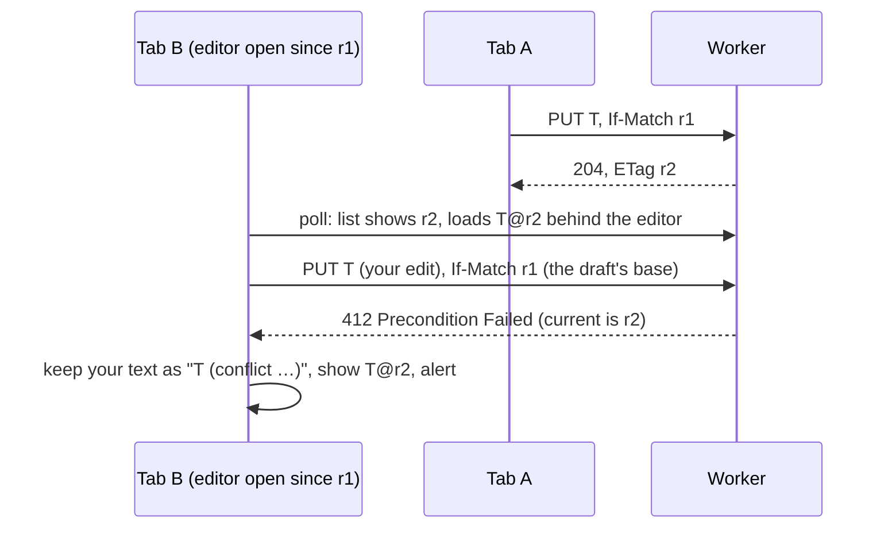
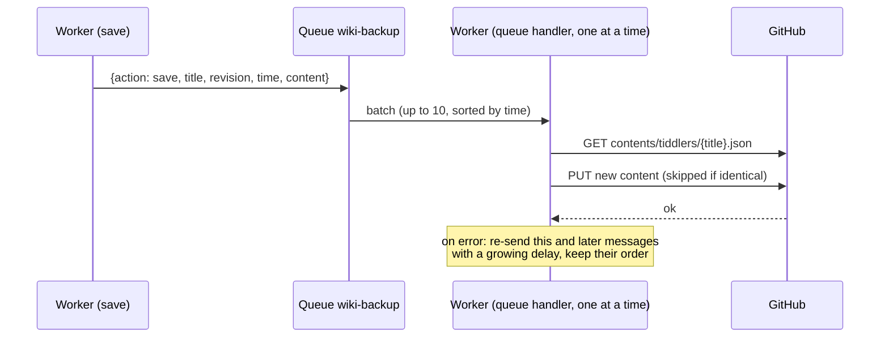
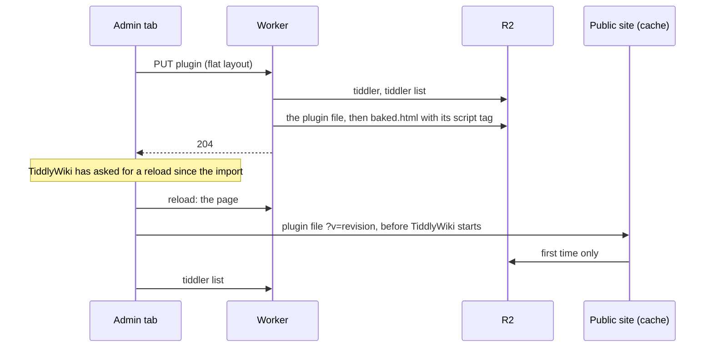

# How it works, and why

The design of the worker: what each part does, and the reasons behind the choices. Setting it up and operating it are in the manual: the [README](../README.md) and the pages beside this one (setup, operating, troubleshooting, limits). Section numbers here are what the code's comments refer to as "[design 1.4](#14-edit-conflict-protection)" and the like.

## Contents

1. [How it works](#1-how-it-works)
2. [Why it is built this way](#2-why-it-is-built-this-way)

---

## 1. How it works

### 1.1 Requests the worker answers

| Request | What happens |
|---|---|
| any, without Cloudflare Access | `403`, before anything else: the request didn't come through Access ([setup 2.6](setup.md#26-cloudflare-access)). |
| any, with `PUBLIC_WIKI_URL` wrong | `500`, next: the worker isn't set up ([setup 2.5](setup.md#25-the-worker)). Missing, the wiki is private (2.15): the worker serves everything itself. |
| `OPTIONS *` | CORS headers (allows `If-Match`, `If-None-Match`, `X-Tiddler-Layout`, exposes `ETag`, `X-Tiddler-List` and `Retry-After`). |
| `GET /status` | TiddlyWeb status: user `admin`, writable, recipe `default`. Kept by the browser for a week (`Cache-Control: private, max-age=604800`), so admin pages rarely ask (1.5). There's no `/logout`: the dropdown's *Logout* goes to Access's logout page (2.12). |
| `GET /sw.js` | The admin wiki's service worker (1.11), asked for with its version (`?v=`). |
| `GET /manifest.webmanifest`, `GET /_app/icon-<192\|512>.png` | The app's manifest and icons (1.12). |
| `GET /`, `/index.html`, `/baked.html` | The wiki page, rebuilt first if outdated, or `304 Not Modified` when the browser has it (1.3). A bucket without `index.html` gets the empty wiki first (1.3). |
| `GET recipes/default/tiddlers.json` | The tiddler list, or `304 Not Modified` when unchanged (1.5), or `503` while it's being rebuilt (1.2). With `X-Backup-Status: ask`, also how backups go, in the `X-Backup-Status` header (1.7). |
| `GET recipes/default/tiddlers/<title>` | One tiddler as JSON (a flat one exactly as stored, see 1.2), with its revision in the body and the `ETag`, or `304 Not Modified` when the browser has that revision. |
| `GET <any other key>` | That R2 object as is, or `304 Not Modified` when the browser has it (R2's ETag; the object isn't read). |
| `PUT recipes/default/tiddlers/<title>` | Save (1.4): precondition check, conditional write, list update, purge, backup; for a plugin, its file and the page (1.8). Stored flat, whatever layout it arrives in (1.2). A body that isn't a tiddler (a JSON object whose `title` is text, the same as in the URL), or with a value that isn't text, gets `400`. (Every value TiddlyWiki sends is text: a tag `2024` or a field `year: 2024` is the text `"2024"` and is stored like any other. What's refused is a bare JSON number or `null`, which only a script calling the worker could send, and which would otherwise break page builds.) So does a title over 999 bytes of UTF-8 (an R2 key holds 1,024 with `recipes/default/tiddlers/`). |
| `DELETE bags/<bag>/tiddlers/<title>` (or `recipes/<recipe>/…`) | Delete (1.4): same checks, then removal, purge, backup. A title too long to be stored answers `204`. |
| `PUT /page/core?v=<version>-<format>` | TiddlyWiki's core file, from the admin wiki, once per TiddlyWiki version, for the `index.html` it says (`X-Page-Index`, 1.9). |
| `PUT /page/shell` | The page published by the admin wiki, kept and used to build the page (1.9). |
| `POST /backup/sync` | Starts a full backup, GitHub made to mirror the bucket (1.7): `202` with its status, `409` with the running one's, `400` without backups or the queue. |
| `GET /backup/sync` | The last full backup's status. |
| `GET /setup/check` | The setup check (1.13): each piece of the setup looked at, on demand. |
| `POST /engine/update` | The engine update (1.15): `index.html` replaced with the empty wiki the worker ships, on demand from the Cloudflare tab. |
| queue messages | Backup to GitHub (1.7). |

A path that isn't valid percent-encoding (`%E0%A4%A`, say) gets `400`, in any request.

**Ephemeral titles.** These are never stored or backed up: `$:/StoryList`, `$:/HistoryList`, anything under `$:/state/`, `$:/temp/` or `$:/status/`, and drafts, recognised by their `draft.of` field (even an empty one, as TiddlyWiki tells them). A title alone doesn't make a draft: a tiddler called `Draft of 'Chapter 1'` is saved like any other, and only `$:/StoryList` itself is a tab's own: a second story river's `$:/StoryList/2` is stored like any tiddler. A `PUT` of one answers `204` with a throwaway ETag, and a `DELETE` answers `204`. In practice the browser doesn't send them: TiddlyWiki's own sync filter leaves out `$:/HistoryList`, `$:/state/`, `$:/temp/` and `$:/status/`, and the conflict guard also leaves out drafts and `$:/StoryList` (1.5).

### 1.2 Storage, revisions and ETags

R2 layout:

| Key | Content |
|---|---|
| `index.html` | The wiki engine you uploaded. |
| `status` | The public site's TiddlyWeb status, written by the worker on the first visit ([setup 2.8](setup.md#28-the-first-visit)). |
| `baked.html` | Generated: the page (the published shell, or `index.html`) plus the tiddlers needed at startup (1.3). |
| `_page/shell.html` | The page published by the admin wiki, without the core (1.9). |
| `_plugins/tiddlywikicore.js` | TiddlyWiki's core file, published by the admin wiki (1.9). |
| `manifest.webmanifest`, `_app/icon-192.png`, `_app/icon-512.png` | Generated: the public site's copy of the app's manifest, written with the page, and the icons, the defaults unless you replace them (1.12). |
| `recipes/default/tiddlers.json` | The "skinny" tiddler list, as compact JSON: title, tags, type, dates, custom fields and revision for every tiddler, but no text. If it's ever missing or damaged, the worker rebuilds it from the stored tiddlers (below). |
| `recipes/default/tiddlers/<title>` | One tiddler as JSON, flat (below), under its raw title. |
| `_plugins/<title>.js` | Generated: the script that loads a plugin or JavaScript module into the page (1.8). |
| `_backup/versions/…` | Temporary copies of large versions waiting to be backed up (1.7). |
| `_backup/status.json` | The backups GitHub keeps refusing, and a pause of every backup, while there are any; the last full backup's status (1.7). |
| `_repair/…` | Left by a rebuild of the tiddler list: the damaged copy, and the progress of a rebuild that takes several requests (below). |

**Revisions.** Each save gets a new revision, `Date.now()` in milliseconds. It's stored in three places that always agree: the object's custom metadata, the `revision` field inside the tiddler JSON, and the tiddler list. `GET`, `PUT` and `DELETE` all read it from the metadata, which avoids false conflicts.

**One layout.** Every tiddler is stored *flat*: every field at the top level, compact JSON, `text` last, then `revision`, `bag` and `recipe`, with `layout: flat` and the revision in the object's metadata. The conflict guard sends saves that way, with the header `X-Tiddler-Layout: flat` and without `revision`, `bag` or `recipe`. The worker then parses only the few hundred bytes before `"text"` and appends its `revision`, `bag` and `recipe`, working on the raw bytes: it never decodes, parses or re-encodes the text itself, which for a plugin is the whole plugin. It only checks that the text is a string that ends the body: it opens with a quote, and the body ends with one that isn't escaped. Up to 256 KB, it also checks that no field follows the text (scanning for the first quote that isn't escaped); a bigger body isn't scanned, since that costs milliseconds of CPU a megabyte, and the browser module always puts the text last. Anything else is parsed and turned into that layout first: a body sent with the header but not in the layout (pretty-printed, with `revision` before `text`, or with a field after the text), or TiddlyWeb's layout, with custom fields nested under `fields`, which TiddlyWiki sends without the guard. Field values must be text or lists of text, as TiddlyWiki's are; a value that's an object (only a script could send one) is refused with `400`, and so is a `text` that isn't text. One field is the exception: a field called `fields` stays nested, as `"fields":{"fields":"…"}`, the way TiddlyWeb's layout has it, because a flat `fields` is where TiddlyWiki's loader looks for nested custom fields. A rebuilt list only includes objects in this layout: anything else in R2, left by an older version or uploaded by hand, is left out, with a line in the logs ([operating 3.8](operating.md#38-log-lines)).

| Plugin size | Worker CPU to handle the body, parsed (TiddlyWeb's layout) | Flat layout |
|---|---|---|
| 240 KB (markdown) | about 2.6 ms | about 0.1 ms |
| 735 KB (KaTeX) | about 6.5 ms | about 0.3 ms |
| 945 KB (geospatial) | about 10 ms | about 0.4 ms |

Measured in Node.js (the same JavaScript engine as Workers) on a development machine, so only the proportions matter.

**A tiddler saved before its text has loaded keeps its text.** After a page load, TiddlyWiki has every tiddler's fields from the list (each entry marked `_is_skinny`) and loads the texts one by one. A tiddler changed before its text arrived (a checkbox clicked during that time, say) is saved without it: the worker then keeps the stored text, as TiddlyWiki's own server does, and doesn't store the mark; the tab loads the text right after. Only such a save reads the stored tiddler. A text sent with the mark was typed into the empty editor of such a tiddler (opened offline, say: TiddlyWiki's draft copies the mark, and the editor starts empty): it's what was meant, and is stored as sent; only a save without a text, or with an empty one, keeps the stored text.

**The list is served as stored.** Every entry the worker writes has its `bag` and `recipe`, so the list goes out as R2 has it, without being written out again; only a list without them (written by hand) gets them added on the way out. It's still parsed, to tell a damaged one.

**The list keeps the newest.** It's updated with a conditional write, retried if another request changed it in between. A retried write can therefore land after a later request for the same title: an older save then doesn't replace the newer entry, and a delete doesn't remove a title that was saved again since (both compare revisions). One exception: a save that lands between a delete's check and its removal is removed with it, since an R2 delete can't be conditional; the delete sees nothing stored and removes the entry too. And a save whose list write is retried after a delete's (the delete removed the object, this save's version or the one it was based on, and the entry) finds its title unlisted: it looks the object up, one `head`, and lists it only if it's still there at this save's revision; what's gone, or was recreated since, is left to the request that did it.

**A damaged or missing tiddler list rebuilds itself.** The list is only an index: every tiddler is also stored on its own, with all its fields. If the list can't be read (a bad upload or a hand edit) or is missing, the worker rebuilds it from the stored tiddlers wherever it needs it (serving it, a save, a delete, a page build) and carries on. Nothing needs doing by hand, and nothing runs in the background: the requests do the work.
- **It reads as little as it can.** A tiddler's fields come before `"text"`, so it reads only the first 16 KB of each object (more only for fields bigger than that). Each tiddler is listed under the title it's stored under. Objects not in the stored layout (an older version's, or uploaded by hand) are left out, with a line in the logs.
- **A big wiki takes several requests.** A request may make 1,000 R2 calls and use about 10 ms of CPU, so each request reads up to 100 tiddlers and keeps its progress in `_repair/`. Meanwhile the list, saves and deletes answer `503` with `X-Tiddler-List: rebuilding`, before changing anything (unless the list is damaged in the middle of that very request). The open tab sends them again at once, quietly (the conflict guard does this; roughly a second per 100 tiddlers), and each of those requests takes the next step. The damaged list is replaced only when the new one is complete. That last step writes the list as the steps built it, without parsing it, so it costs no more than the others.
- **Public tabs keep their tiddlers.** They read the list straight from R2. A missing list is replaced by a short text while it's rebuilt (each rebuild has its own, so it can't be mistaken for another one's). It isn't JSON, because TiddlyWiki removes every tiddler that isn't in the list it gets, and would take any JSON for one. The conflict guard recognises that text and fetches the list again every few seconds, at a URL no cache holds, and turns a list it can't read (a damaged upload) into an ordinary sync error, after asking once more past any cached copy, instead of TiddlyWiki's "Internal JavaScript Error". A tab without the guard (`CONFLICT_GUARD=off`, or a page opened before this version) stops syncing with that error, but still keeps its tiddlers.
- **Nothing is lost.** The damaged copy is kept in `_repair/` in case it held a hand edit you want to redo; delete it when you no longer need it. The new list holds exactly what is stored, so a hand edit to the list itself is gone, but no tiddler is.
- **The page is rebuilt on the next admin page load**, as the rebuilt list may differ from the one it was built from (a plugin saved by a tab closed before its list update was retried, say).
- **Progress is deleted when the rebuild completes.** If you repair the list yourself in the middle of one, its progress file stays in `_repair/` and does nothing; the next rebuild replaces it.

Deleting `recipes/default/tiddlers.json` in R2 has the same effect, which makes a rebuild easy to force.

**ETags** follow TiddlyWeb's format: `"default/<url-encoded title>/<revision>:auto"`. TiddlyWiki reads the revision from the ETag of each save response.

### 1.3 The wiki page (`baked.html`)

**The first visit.** A page request that finds no `index.html` in the bucket first puts the empty wiki there (`seed/empty.html`, uploaded with the worker as a text module: not as a static asset, which would put a router in front of the worker that drops Cloudflare Access's mark, [setup 2.6](setup.md#26-cloudflare-access)), with the public site's `status` file, both create-only, so nothing already in the bucket is replaced: an `index.html` deleted by hand gets a fresh engine, and the stored tiddlers stay. Then the page is built as for any new `index.html`. Without the module (a pasted worker) the page answers `404` saying what to upload. The page carries the TiddlyWiki version of what it was built from (the `<meta name="tiddlywiki-version">` tag of `index.html` or of the shell, read at the build) and the version of the empty wiki the worker ships (a build constant, part of the plugin's version so a new one rebuilds the page), in `$:/cfworker/page-source`: the Cloudflare tab compares them (1.15).

TiddlyWiki only runs JavaScript modules, plugins and startup actions that are present when the page boots. Tiddlers loaded later through sync arrive too late. So the worker builds `baked.html` from the page source, which is the shell the admin wiki published when there's one for the current `index.html` that loads the core file from where the page would, and `index.html` itself otherwise (1.9). It adds, right after `<head>`, a `<script>` that preloads these tiddlers (`$tw.preloadTiddlers`):

- `$:/DefaultTiddlers`, `$:/SiteTitle`, `$:/SiteSubtitle`
- `$:/SiteUrl`, `$:/SiteDomain`, `$:/SitePreviewUrl`: TiddlyWiki 5.4's link-preview tags read them when the admin wiki renders the page (1.9), in a way that loads nothing, so every tab has to have them
- `$:/theme`, `$:/language`, `$:/palette`: TiddlyWiki reads them at boot to choose the theme, language and palette
- the sync settings `$:/config/SyncPollingInterval`, `$:/config/SyncThrottleInterval`, `$:/config/SyncFilter`, `$:/config/SyncDisableLazyLoading`: TiddlyWiki's syncer reads them once, when it starts
- plugin disable flags, `$:/config/Plugins/Disabled/…`: read at boot too
- every tiddler tagged `$:/tags/StartupAction` or one of its variants (`$:/tags/StartupAction/Browser`, `…/PostRender`)
- the admin plugin, `$:/plugins/cfworker/admin` (2.21): one plugin tiddler whose parts are the browser modules (`src/browser/`) and their settings — shadow tiddlers once TiddlyWiki unpacks it at boot, out of search and out of syncing, overridden only on purpose; Control Panel → Plugins lists it with the worker's version (`package.json`'s, plus the hash of everything else in the plugin: the modules, the service worker's address, the three tabs, its fields) and three tabs, a readme, the settings and the device (`src/browser/plugin-readme.txt`, `plugin-settings.txt`, `plugin-device.txt`). The modules: the library `$:/cfworker/lib.js` the others require, the conflict guard `$:/cfworker/conflict-guard.js` (saves and deletes, 1.4), the list sync `$:/cfworker/list-sync.js` (the tiddler list, reads from the public site, what isn't sent: 1.5), the backup alert `$:/cfworker/backup-alert.js` (1.7), the page publisher `$:/cfworker/page-publisher.js` (1.9), and the restore import `$:/cfworker/restore-import.js` (the backup's files dropped onto the wiki, 1.7), the control panel's Cloudflare tab `$:/cfworker/control-panel.js` (how backups go, the full backup, 1.7; the setup check, 1.13), and the outbox `$:/cfworker/outbox.js` (every change kept on the device until the worker has it, 1.10), the cold start `$:/cfworker/cold-start.js` (the service worker registered, 1.11), and the device tab `$:/cfworker/device.js` (what this browser keeps, measured, kept or forgotten, 1.14). The settings:
  - `$:/cfworker/sw-url`: the service worker's address, `/sw.js?v=<its version>` (1.11)
  - `$:/cfworker/public-url`: the public address, read by the modules; empty for a private wiki (2.15). A page on that site, whatever the protocol (visited over `http` while the address says `https`, say), is the public site: read-only, nothing published. Any other site, or any site when there's no public address, is the admin site (`lib.onAdminSite`)
  - `$:/cfworker/page-source`: what the page was built from (the `index.html` ETag, the shell's fingerprint, the stored core file's version), read by the page publisher (1.9)
- the wiki's own settings for the modules, `$:/config/cfworker/…` (the plugin's settings tab): the fill of the device copy (`LoadAll`, 1.5) and the advanced ones, each read by its module at the moment it's used, so a change applies at once — `DraftPause` (ms before a draft is written to the device, 1.10), `FetchAhead` (tiddlers fetched at once during the fill, 1.5), `PublishPause` (ms after a save before the page is published, 1.9), `BackupCheckMinutes` (between asking how backups go, 1.7) — and `NetworkWait` (seconds the service worker waits for the network before the kept page, 1.11), which the page tells the service worker at each load, since it reads no tiddler

and, after that script, the app's links (1.12): the manifest, a theme colour, the iOS icon.

An override of a part — a tiddler saved under its title — works as for any plugin: a module's goes into the page as a plugin file (1.8), the override wins at boot, and it stays through the worker's updates until deleted. The plugin tiddler itself is never a file (`needsPluginFile`) and never published (the page publisher leaves it out): the worker puts it in every page it builds.

then one `<script src="…">` per plugin and JavaScript module (1.8). In a page built from the shell, those tags go right before TiddlyWiki's `<!--~~ Load external JavaScripts ~~-->`, at the end of the page: they still run before TiddlyWiki starts (the core file starts it), but no longer hold up the top of the page, such as a splash screen. In a full `index.html`, where TiddlyWiki starts from code inside the page, they go in `<head>`. The browser modules, the public address and the page source are left out when `CONFLICT_GUARD` is `off`.

**The browser keeps the page.** The page goes out with an ETag, `"<baked.html's R2 etag>-page"`, and `Cache-Control: no-cache`, so the browser asks at each load whether it changed. If it hasn't, the worker answers `304 Not Modified` without even reading the page's body from R2, and nothing is downloaded. A page that has to be rebuilt is sent in full, with the ETag of the page it stored, so the load after a rebuild (after a deploy, say) is already a `304`.

**Behind Cloudflare, the browser asks by date.** Cloudflare features that rewrite HTML remove the ETag on the way out. One of them, *Replace insecure JavaScript libraries*, is on by default on the Free plan, can only be turned off for the whole zone, and a configuration rule can't change it. So the page also carries `Last-Modified`, which they keep, and the browser then asks with `If-Modified-Since`. The date is the page's version, not just a time: it's set when the page is stored (`pageTime` in its metadata, in seconds), always later than the previous page's, even for two pages built within the same second, and the worker answers `304` only when it matches exactly. For the browser, the `304` is the same. In the worker it costs a little more: R2 can't check this date by itself, so the page's body is opened and cancelled unread. JSON responses keep their ETags: those features only touch HTML.

Stored tiddlers are baked as they're stored: flat, already the form `preloadTiddlers` expects. (A field called `fields` is unpacked first: TiddlyWiki does that itself only for tiddlers it loads through sync, 1.2.) The page is edited as bytes, without decoding `index.html` (a few MB) into a string and back, which costs about ten times more CPU. Text containing `$&`, `$1` and the like is copied literally.

**When it's rebuilt:**
- **On a page request,** if `baked.html` is missing, or was built by a different version of the plugin (`pluginVersion`: its modules, the service worker, its tabs, its fields, the package version) or of the page format, or for a different public address (`bakeVersion` in its metadata), or from a different `index.html` (`sourceEtag`). Deploying a worker that changes what the page carries, or uploading a new `index.html`, therefore takes effect on the next admin page load; a deploy that changes only the worker's own code leaves the page as it is.
- **After saving or deleting a tiddler the page needs at boot:** one of those listed above, a plugin or a JavaScript module. That includes a tiddler that *stops* being needed, such as a startup action losing its tag. The save waits for the rebuild, so a reload right after it already gets the new page. If the rebuild fails (an R2 error), the save is still stored and confirmed, and the page is marked outdated, so the next page load builds it, writing any plugin file that's missing. The mark writes the same object the build just failed on (R2 takes one write a second to an object), so if it fails too it's tried once more a second later; if that fails as well, the save or delete answers `500` with the change stored, and the browser's retry finishes it: a plugin deleted, or saved as an ordinary tiddler, whose file is still there gets the page rebuilt without it and the file deleted. Without that, the retry would find nothing left to do, and the page would keep loading the plugin from its file on both sites.
- **After the admin wiki publishes a new shell** (1.9).

Two builds can overlap (two tabs saving at once, a save during the first load after a deploy, or while a new shell is published). Each page records when the tiddler list and the shell it was built from were stored in R2 (`listVersion`, `shellVersion`), and a build doesn't replace a page built from a newer one of them and no older one of the other: a save that read the shell just before a new one was published doesn't put the old shell back. In the rare case where each page has the newer one of the two, the later is stored but marked outdated, so the next page load builds it from both. This is best effort: after two lost races, the last attempt writes anyway.

After each rebuild that saves the page, the worker purges `/` and `/baked.html` on the public site.

### 1.4 Edit-conflict protection

**The problem.** TiddlyWiki's TiddlyWeb adaptor never says which version an edit is based on: no `If-Match` header. The server therefore can't tell a normal save from one that overwrites someone else's newer edit. The original worker's logs show this: not one request carried `If-Match`.

It's worse than "two tabs saving at once". Each tab checks the server every minute and quietly loads newer versions, including behind an editor you have open. So the tab "knows" the latest revision even though your edit started from an older text. A naive `If-Match` using that latest revision would approve the overwrite.



**In the browser (the conflict guard module):**

- **Every save says what it's based on.** It sends `If-Match` with the base revision, or `If-None-Match: *` for a tiddler the server shouldn't have yet. That includes a tiddler that came with the page, such as a theme or plugin from `index.html`: it carries a revision the worker never gives (`0` in a published page, a change count in `index.html`), so updating it (from the plugin library, say) creates it on the worker, and is a conflict only if another tab stored it first. If the revision is unknown, nothing is sent and the save is unconditional.
- **Drafts remember their starting point.** When an editor opens, the module records the revision the draft was copied from. When you confirm the edit, that becomes the base of the save, even if the tab has synced newer versions since. After the tab's own successful save, anything based on the old revision moves to the new one, so quick consecutive edits in one tab never conflict with themselves.
- **Deletes send `If-Match` too.** A rename deletes the old title, and so does deleting from an open editor: those deletes are based on the revision the editor started from, like the save. So if another tab saved a newer version meanwhile (even one this tab has loaded behind the editor), the delete is refused rather than removing that version. That base is kept until the tab has the server's version: if fetching it fails, the delete is tried again from the same base, and refused again.
- **On `412` for a save:**
  1. The module fetches the server's version.
  2. If it has the same content as yours (ignoring `revision`, `bag`, `recipe`, `permissions`, `modified` and `modifier`), it simply adopts it: no copy, no alert.
  3. Otherwise it saves your version as a new tiddler, `Title (conflict YYYY-MM-DD hh.mm.ss)` (with `Title` shortened, ending in `…`, if the copy's name would be too long for the worker: 999 bytes). That copy gets a `conflict-of: Title` field. System tags (starting with `$:/`, such as `$:/tags/Stylesheet` or TiddlyWiki's older `$:/core/wiki/rawmarkup`) are moved into `conflict-removed-tags`, and `module-type` and `plugin-type` into `conflict-removed-module-type` and `conflict-removed-plugin-type`, so the copy stays inert instead of acting as a second stylesheet, macro set, startup action, JavaScript module or plugin (a plugin copy's contents would even override the original's). The alert says so for such a copy: to use that version, copy its text into the original, or, if the original was deleted elsewhere, rename the copy to its title and give it back its `module-type` or `plugin-type`.
  4. The copy opens in the story river, the original shows the server version (or disappears, if it was deleted elsewhere), and an alert explains what happened, with links.
- **On `412` for a delete:** the newer server version is restored and an alert says it wasn't deleted.
- **A background reload never overwrites unsaved local changes.** If a tiddler has changes waiting to upload, the reload is skipped, and the pending save detects any conflict instead.

**On the server:**

- **`PUT` and `DELETE` check `If-Match` and `If-None-Match`** against the current revision. They accept full ETags, bare revisions, weak (`W/`) forms and `*`, and answer `412` with the current `ETag` on a mismatch.
- **For a save that carries a precondition, the R2 write itself is conditional.** It uses `etagMatches` on the object that was checked, or `If-None-Match: *` for a new tiddler. Two saves arriving at the same instant therefore can't both succeed: exactly one wins and the other gets `412`.
- **Requests without precondition headers are still accepted**, as before. These come from tabs opened before the module existed, and from scripts.
- **A retried save that's already stored is finished, not refused.** The worker stores the tiddler, then updates the tiddler list. If the list update fails, the browser retries the save with the same precondition, which no longer matches. When the stored tiddler is byte for byte what that save would store, the worker completes the list update and answers as if it had just saved it. Without this, the conflict guard would adopt the identical copy, the list would never be fixed, and the tiddler would vanish from every tab at the next poll. Different content still gets `412` (the tab may have edited again before its retry, or it's another tab's stale save: the worker can't tell), but that stored save is finished all the same, so the list, the public cache and the page don't stay behind it.
- **A tab recognises its own earlier save.** A save that gets an error may still have been stored (the answer lost on the way, say). The browser module remembers it, and if the next try is refused, it fetches the server's copy as usual: when that copy is exactly the save that got the error, it's this tab's own, so the newer content is sent again based on it, with no conflict copy — with that try's own headers: a new tiddler's first try says `If-None-Match: *`, and a retry that kept it beside its `If-Match` was refused again, a conflict copy made of the tab's own text (the headers were one object, changed in place; each try now makes its own). Identical content also counts a tiddler created in this tab, without a type, as having the default one the browser module sends.

To find conflict copies later, use the filter `[has[conflict-of]]`. What a user sees of all this is [operating 3.20](operating.md#320-when-two-tabs-edit-the-same-tiddler).

### 1.5 Keeping worker requests down

On an admin page load the worker sees only two requests: the page (usually a `304`, 1.3) and the tiddler list (often a `304` too). TiddlyWiki also asks for `/status` before it fetches the list. The answer never changes, so the worker lets the browser keep it for a week (`private`: that browser only): only the first load in a browser that week asks the worker, and the others don't wait for its answer before your tiddlers appear. Public tabs read their `status` file ([setup 2.8](setup.md#28-the-first-visit)), which the browser can keep for a week too ([setup 2.7](setup.md#27-the-zones-rules-public-site-only)). While a tab is visible the worker sees one list request a minute, plus your saves.

| Change | Effect |
|---|---|
| **Tiddler contents come from the public site.** After reading the list, TiddlyWiki fetches every tiddler's full text one by one. The module fetches each from the public site instead (same R2 object, served by cache or R2). A private wiki has no public site: from the worker, once per device (the next row). | Removes one worker request per tiddler per page load. |
| **Each public copy is checked.** It's used only if its `revision` equals the one in the worker's list. Otherwise it's asked for once more at a URL no cache holds (`?cfworker-retry=`), and if that isn't the listed revision either, or on any error (including a missing CORS header), the module falls back to the worker, and also when the public site doesn't answer within 5 seconds, so a hanging site can't hold up loading. | A stale cached copy can never be loaded into the admin wiki, and a cache that kept one costs no worker request. |
| **Loaded tiddlers are kept on the device.** Every tiddler a tab loads or saves goes into the browser's IndexedDB with its revision (one database per site). A load first looks there, and uses the copy only if its revision is the one the worker lists; entries the list no longer has are pruned — by a real list, never by one the service worker answered from its cache (1.11). | A page load fetches the list and the tiddlers that changed since the last visit, nothing else: a 1,000-tiddler wiki opens again with one request, on a phone too. Where storage is unavailable (a private window, say), loads fall back to the network. |
| **What's shown loads first, the rest fills in several at a time.** Since 5.1.23 TiddlyWiki loads every tiddler in full after the list, one at a time, in the list's order, so a tiddler opened directly waits for everything before it. The module arranges the loads: a tiddler whose text is needed (opened, transcluded, in the story at startup) goes to the front; the fill waits a moment after each list so the page can ask, pauses while the tab is hidden, and looks the next tiddlers up ahead of TiddlyWiki (24 at a time, 6 of them over the network) and stores the ones that have arrived together, one refresh for all of them. With `$:/config/cfworker/LoadAll` set to `no` there is no fill: a tiddler loads the moment its text is needed, and text search and backlinks see only the loaded ones ([operating 3.10](operating.md#310-loading-a-big-wiki)). | A tiddler opened directly appears after one request; a first visit fills a 1,000-tiddler wiki in seconds instead of minutes; a hidden tab costs nothing. |
| **The page publisher doesn't wait for the fill.** It waits for saves and for loads of tiddlers the page needs (plugins, raw markup), not for the queue to empty (1.9). | The page is published after a save even while a big wiki is still filling in. |
| **The tiddler list stays on the worker.** | It's the up-to-date source of truth that the checks above rely on (2.8). |
| **`304` for the tiddler list.** The browser revalidates with its ETag, and when nothing changed the worker answers `304` without reading and rewriting the list. Weak `W/"…"` ETags, which Cloudflare's compression produces, are accepted. | Cheaper polls (still one request each). |
| **`304` for a tiddler or a file.** The same for the admin wiki's reads from the worker (one whose public copy is stale or missing, or the conflict guard reading the server's version): a browser that has it gets `304` and no body. A tiddler is still read (its revision is in its metadata); a file isn't even that. | Nothing downloaded twice. |
| **Drafts and `$:/StoryList` aren't synced.** | No request per navigation or per draft autosave. It also fixes a real bug (2.7). |
| **The "put" saver is switched off.** It probed the page URL with `OPTIONS` and `HEAD` on every load, but can't save to this worker. | Two fewer requests per page load. |
| **Hidden tabs don't poll.** While a tab is in the background, the minute-by-minute check is postponed. When it becomes visible again, it checks right away if the last check is more than 10 seconds old. Saves from a hidden tab still go out. | No polling from forgotten tabs. A visible tab still polls every minute. |

### 1.6 Public cache purges

After a change, the worker asks Cloudflare to purge exactly these public URLs. It's a single-file purge, never "purge everything". A private wiki has no public site, so nothing is purged, whatever `CF_ZONE_ID` and `CF_API_TOKEN` say.

- **After a save or delete:**
  - the tiddler's URL, `/recipes/default/tiddlers/<title encoded with encodeURIComponent>`, the same way TiddlyWiki requests it;
  - the same URL again, with the header `Origin: <the admin site>`. The admin page reads tiddlers from the public site cross-origin (2.8), so its requests carry that header, and Cloudflare keeps the `Origin` header in the cache key: the admin page's copy is a separate cache entry, which a purge of the bare URL leaves in place;
  - `/recipes/default/tiddlers.json` without a query string;
  - the same URL with the `?filter=…` query TiddlyWiki adds, for both the 5.4 filter and the filter of earlier versions (`SKINNY_LIST_FILTERS` in the source). The cache key includes the query string, so it has to match exactly.
- **After `baked.html` is rebuilt:** `/` and `/baked.html`.
- **After the tiddler list is rebuilt (1.2):** the list URLs above, at once and again 5 seconds later, in case a public request that read the damaged list or the stand-in was still under way.

Purges aren't awaited: they run while the response goes out, and failures are logged (`Cache purge failed`). A save purges the tiddler list only once the new list is stored, so a request in between can't put the old list back in the cache.

### 1.7 GitHub backup



1. **A save or delete adds a message** after it has been stored: `{action, title, revision, time, tries, content}`.
   - Messages are kept under 64 KB as sent, where a text takes one byte a character if they're all Latin-1, and two otherwise (so a 40 KB text with one `€` is too big). The queue takes up to 128 KB, but counts an operation per 64 KB of message, so a bigger one would cost 6 operations instead of 3. A version that would make the message bigger is stored in R2 under `_backup/versions/`, with a random name, and the message points to it.
   - If the queue isn't bound or can't be reached, the worker runs the same backup routine (steps 3–5) directly, trying up to 3 times (two retries, 1 and 2 seconds apart).
2. **The queue handler takes up to 10 messages per run, in save order.** With *maximum concurrency 1* there's only ever one run, so commits never collide. Once a run has handled 512 KB of versions, the rest go on to the next run: it always backs up one version, whatever its size, but not several big ones (a megabyte takes about 3 ms of CPU, and a run gets about 10 on the free plan).
3. **For a save,** it asks GitHub for the file's `sha` (git's blob hash, which GitHub needs to replace a file) and commits the new content. If GitHub already has exactly that content, it skips the commit, so a message delivered twice makes no duplicate: the hash of a content is always the same. GitHub sends the file's content too, but it isn't decoded: for a plugin that took more CPU than a run is allowed. The new content goes to GitHub in base64, written straight into the request's bytes, never as a string of the whole: for a 1.5 MB plugin that's about 5 ms of CPU for the whole backup, where encoding through strings took 21 (4.7 MB: 13 ms instead of 72). The encoding itself is the runtime's own where it has one (`Uint8Array.prototype.toBase64`, native in Workers), in slices of 3 MB written into the body as they come — the same bytes as the JavaScript loop kept for a runtime without it, in about half the time warm and a third on the first run in a fresh isolate, where the loop isn't optimised yet; the slices keep the string beside the body at 4 MB, where the whole at once would take a 30 MB plugin's run past the isolate's 128 MB (measured in workerd, `test/cpu.test.mjs`).
4. **Late arrivals keep both history and the right final state.** If a version reaches GitHub after a newer one of the same tiddler (because it had to be retried), it's still committed, so it's in the history. Then the newer version is committed back on top, with the message `(newer version restored)`. A version is late when the wiki holds a newer one *and* GitHub already holds that one (its hash matches GitHub's `sha`); a newer version still waiting for its own backup (quick successive edits) is simply committed by its own message, in order. If putting it back fails, the retried message still does it. If the tiddler was deleted in the meantime, the late version is committed and then deleted again.
5. **For a delete,** the file is removed if present. If the tiddler has been recreated since, the delete is skipped, because the recreation's own message updates GitHub.
6. **On any GitHub error** (rate limit, outage, bad token, conflict, a path GitHub refuses), the failing message is sent to the queue again as a fresh message, with a delay. An error that may concern this file only (an outage answer, a conflict, a path GitHub refuses) holds up only that tiddler's later versions, so they stay in order, while other tiddlers' backups go ahead: a file GitHub keeps refusing can't hold up the rest. A version GitHub refuses for good (`409` or `422`: a path it won't take, or a secret its push protection found in the text) doesn't even hold up its own tiddler: the later versions go ahead, since the next one may well be fixed. The refused one is still retried, in case it's accepted after all, but once a newer version is on GitHub, or the tiddler has been deleted, it's dropped: it would only have been history. The delay starts at `BACKUP_RETRY_SECONDS` (60), doubles each time up to 6 hours, and honours GitHub's `retry-after` / `x-ratelimit-reset` when given. Re-sending, instead of using the queue's own retry, means neither the queue's retry limit nor its message lifetime (24 hours on the free plan) can drop a backup: a failure only delays it. A message that only waits, though (in a pause, behind an earlier version of its tiddler, or for the next run), uses the queue's own retry while that's safe: it costs 1 operation, the next delivery, instead of 3 for a fresh message. Safe means a retry to spare under the default limit of 3 (so a message is delivered at most 3 times before it's sent again fresh), and an hour to spare before 24 hours since it was sent. In the tests, 20 backups waiting on a refused token, then going through, take 164 queue operations instead of 240. Only if re-sending itself fails does the worker fall back to the queue's own retry, where the retry limit applies.
7. **Some errors pause every backup:** GitHub asking to slow down (a rate limit), and a token it refuses (`401`: expired or revoked). Trying the others one by one would only get the same answer, for a GitHub call and a few queue operations each. So every backup waits: the rest of the batch, and every backup delivered until the pause ends is sent back to wait for its end, without calling GitHub. Then the first one tries. If GitHub still refuses, the next pause is twice as long (from `BACKUP_RETRY_SECONDS` up to 6 hours, or as long as GitHub asks); the first backup that goes through ends it. A `403` (a token that can't write to the repository, an archived repository) or a `404` on a write (a repository the token can't see, or that doesn't exist) pauses them too, but only once two tiddlers get it in the same run: either can also concern one file (a path GitHub can't take), and one file mustn't hold up all the others. The pause is known to the next runs on the same worker instance; its end and length are kept in `_backup/status.json`, for a run on a new one. With 20 backups waiting on a refused token, that's 3 GitHub calls in 6 seconds instead of 60.

Commit messages: `✏️ Save: <title>`, `🗑️ Delete: <title>`, and `✏️ Save: <title> (newer version restored)` for the case in point 4.

**Failing backups show in the admin wiki.** Retrying means nothing is lost, but also that a token GitHub no longer accepts (an expired one, say) would otherwise only show in the worker's logs, for months. So:
- **The queue handler records each tiddler GitHub keeps refusing** in `_backup/status.json`: since when (the save of its oldest waiting version), GitHub's answer and its HTTP status. (Readable on the public site like everything in the bucket, it shows nothing new: the titles are in the public tiddler list already, and GitHub's answers hold no secret.) Rate limits aren't recorded: they only make backups wait, for hours during a big import. During a pause for a token GitHub refuses (1.7, point 7), every backup that waits is recorded, so none is left out of the count. The entry goes once that tiddler's backup gets through, and the file once none is left (and no pause). The file is written only when something changes, and read only by a run with a failure, a retry or a pause, and once per worker instance at its first backup that goes through, for the titles recorded: a backup of such a title that goes through clears its entry whatever its own history (a fresh save of a tiddler a full backup found refused, fixed since), and a full backup step clears what it commits or finds GitHub already has. A direct backup (no queue) records its failures too, and reads the file after each backup that goes through, to clear its entry: without a queue, a backup doesn't know whether it failed before.
- **The admin wiki asks with its tiddler list request** (header `X-Backup-Status: ask`): when the page loads, then once an hour, and at each request while the alert shows or a full backup runs. Only then does the worker read the file, at the same time as the list, and answer in a header of that response, a `304` included. No extra request.
- **An alert** ("GitHub backup") then says since when backups fail, how many tiddlers wait and the oldest, GitHub's answer, and what to do: for a `401`, make a new token and update the `GITHUB_TOKEN` secret. Only backups failing for at least `BACKUP_ALERT_MINUTES` (60) are reported, so a short GitHub outage doesn't raise one. It goes away by itself once they get through. Dismissed, it stays away for that problem; a reload shows it again if it's still there.
- **A backup the runtime cuts short is noted before it's tried.** A run that exceeds its CPU time (the free plan's 10 ms, on a version of several MB) is ended by Cloudflare: nothing after the cut runs, the queue delivers the batch again, three times the same way (`max_retries`), then drops it, and no catch block ever saw it. So before the heavy part of a version over 1 MB (`BIG_BACKUP_BYTES`: the bytes copied, hashed and encoded), the queue handler writes a note in `_backup/status.json` (`running`: the title, its revision, size, when, the delivery's attempt; a full backup's step notes its id too) and clears it once done with the version, however that went: two R2 calls for the note and two for its clearing, big versions only, nothing for the rest. A note whose attempt was the last delivery, or left for 15 minutes (a backup takes seconds, the retries follow within minutes), is reported to the admin wiki as `stuck` (the oldest, how many), and shown as an alert: the tiddler, its size, how many times it was cut short, what that most likely is ([limits 5](limits.md)), and that GitHub keeps the last version that went through. A backup of the tiddler that goes through (its next save) clears the note; one left for a day is dropped like a failing entry. The direct backup (no queue) gets no note: the save's own request answers its error.

**A full backup makes GitHub mirror the bucket** (`POST /backup/sync` from the control panel's Cloudflare tab; `backup/sync.js`, `queue.js`). The per-save backup covers saves made since backups were set up; what came before (an imported wiki), a restore, a tiddler put in R2 by hand, or a backup GitHub refused for good and that was fixed, leave GitHub behind. The job runs in the queue, as a message that carries where it stands and queues its next step, so a wiki of any size goes through in as many steps as it takes:
- **The push phase** walks the stored tiddlers in key order (`after`: the last key walked), each through the same backup as a save (`backupJob`): GitHub's `sha` is asked, nothing is committed for a tiddler GitHub has the same bytes of, and a file GitHub refuses (its push protection, say) is reported like a save's would be while the walk goes on, and cleared like one, by the save that fixes it or a later full backup. Objects not in the stored layout are left out, as the list leaves them out.
- **The prune phase** lists GitHub's tiddler files in one call (the Git Trees API, the whole branch, subdirectories included) and the stored keys (one R2 call per 1,000), and removes the files whose titles are no longer stored, a step's next message carrying as many of them as fit under a queue message's 64 KB (the tree is listed again past that); a file that changed or went meanwhile (a save or delete that landed) is left alone. A tree too big for one answer (100,000 files) skips the prune.
- **Each step stays within a run's budgets:** the GitHub calls the saves of the same run left (40 of the 50 outside calls a run may make; a step runs only with 8 left, after the saves, one step a run) and the bytes a run may encode (512 KB), so a step is about 20 tiddlers to commit, 40 to check, or one big one. Rate limits and a refused token pause the step like any backup; any other failure retries it with a growing delay, its progress noted as an error meanwhile. 3 queue operations a step.
- **Its status lives in `_backup/status.json`** (`sync`: id, when, total from the tiddler list, phase, steps, done, committed, removed, failed, finished, error), written by each step; the admin wiki gets it in the tiddler list's answer (asked every minute while one runs) and in the trigger's answer, and the tab shows it. Only one runs at a time: a second request is refused with the running one's status, unless it has made no progress for 8 hours (its message lost), in which case a new one replaces it and a late step of the old one does nothing.
- **A hint, once per browser:** when backups are on and no full backup has ever run, the admin wiki says so in an alert pointing to the tab; closing it is remembered on the device, a full backup makes it moot everywhere.

File paths are the ones the original worker used: the Contents API URL `…/contents/tiddlers/<encodeURIComponent(title)>.json`. History therefore continues in the same files.

**Restoring is an import, through a conversion the admin wiki does itself.** Each file is the tiddler as stored: TiddlyWeb's layout, where the tags are a list, with the revision, bag and recipe of the wiki it came from. TiddlyWiki's JSON import keeps only the fields whose value is text, so such a file dropped onto any other TiddlyWiki loses its tags. The restore-import module (`$:/cfworker/restore-import.js`) takes those files over with TiddlyWiki's `th-importing-file` hook, which a drop, a paste and the import button all go through: a `.json` file whose content is a stored tiddler, or a list of them (a title, with a revision, a bag, tags as a list or nested fields), is handed to the import dialog with every field as text (tags as TiddlyWiki writes them, `[[two words]]` included), the nested fields flat, and without the old revision, bag and recipe; any other file, a plain export or an HTML wiki, is read as TiddlyWiki reads it. Each tiddler is then saved as new (the saves carry `If-None-Match: *`, since the tab never knew those tiddlers from the server), stored, listed and backed up like any other. `tools/restore.mjs` ([setup 2.4](setup.md#24-the-backup-repository-optional)) does the same conversion outside the wiki, for merging a whole clone into one file, or for any other TiddlyWiki. The two-tabs suite runs the round trip through TiddlyWiki's own file-import path.

### 1.8 Plugins and JavaScript modules

Plugins have to be in the page when TiddlyWiki boots, and the public site can't run the worker. So each plugin gets a file in R2, and the page loads it with a `<script>` tag from the public site, on both sites.



**What gets a file:** tiddlers with `plugin-type` `plugin`, `theme` or `language` (except `$:/core`, which comes with `index.html`, and plugins marked `platform: server`), and modules: tiddlers with a `module-type` whose type is `application/javascript`, `application/json` or `application/x-tiddler-dictionary`, the types TiddlyWiki defines modules from at boot.

**The file**, `_plugins/<title>.js`, is the stored tiddler, untouched, inside the code the external-plugins export template produces:

```js
{
const tw = globalThis.$tw ??= Object.create(null);
tw.preloadTiddlers = (tw.preloadTiddlers ?? []).concat([<the stored tiddler JSON>]);
}
```

For a tiddler with a field called `fields`, stored nested (1.2), the file has one more line that unpacks it, since TiddlyWiki doesn't for preloaded tiddlers. The file keeps the tiddler's `revision`, so after boot TiddlyWiki finds the same revision in the tiddler list and doesn't download the plugin again.

**The URL** is `https://wiki.example.com/_plugins/<encodeURIComponent(title)>.js?v=<revision>`, on the public site even in the admin page (root-relative, `/_plugins/…`, in a private wiki: the worker serves the file, with the same caching). The file name never changes, and `?v=` changes with every version, so caches never serve an old version and plugin files are never purged. No plugin code ever goes through the worker: it costs no worker request, and the public site's cache serves it ([setup 2.7](setup.md#27-the-zones-rules-public-site-only)).

**When files are written:** while building the page, which checks each plugin's file against the tiddler list (one `HEAD` each) and writes the ones that are missing or out of date from the stored tiddler. So saving a plugin updates its file before the save is confirmed, and the first page load after deploying writes files for plugins already in the wiki. Deleting a plugin, or turning it into an ordinary tiddler, deletes its file, once the page has been rebuilt without it (a page load in between still finds it). If that delete fails, the file is only left behind, unused: the save or delete is still confirmed. When two builds overlap, a file is only written if it's still the one the build looked at, and not replaced by an older version (best effort, see 1.3); each script tag uses the revision the file actually holds.

**Disabled plugins keep their tag.** Their disable flag is in the page, so TiddlyWiki skips them at boot. Leaving their file out would be worse: the sync would fetch the plugin after boot, and TiddlyWiki would ask for a reload on every load.

**Themes and languages** work at boot, since both the plugin and `$:/theme` or `$:/language` are in the page.

### 1.9 The page, published from the admin wiki

When TiddlyWiki saves a single-file wiki, it writes the whole page from a template: the `<title>`, the language, the `$:/tags/RawMarkup…` tiddlers (TiddlyWiki 5.4's own Open Graph tags for link previews among them, from `$:/SiteTitle`, `$:/SiteSubtitle`, `$:/SiteUrl` and `$:/SitePreviewUrl`; a splash screen; web fonts...), the content for browsers without JavaScript. Here nothing saves the file. So the admin wiki renders the page itself, with the same template, and publishes it; the page publisher module does it by itself.

**What it renders.** TiddlyWiki's own `$:/core/templates/tiddlywiki5-external-js.html`, the page of its "external core" edition: everything but the core, which is loaded at the end from a separate file. The template only gets two inputs:
- `saveTiddlerFilter`, the tiddlers in the page: the plugins that came with the page (plugin tiddlers the worker doesn't store: the themes and TiddlyWeb from `index.html`; never `$:/core`, `$:/temp/…` or a pending import), the plugins installed from the wiki that have raw markup (below), and the tiddlers tagged `$:/tags/RawMarkup…` (without drafts). Other installed plugins are only files (1.8), and content stays synced.
- Nothing deleted, in this tab or another. TiddlyWiki keeps `$:/` tiddlers that disappear from the server in tabs already open, so "not stored" alone can't tell a theme from `index.html` from a plugin deleted elsewhere. What tells them apart is when: the tab records what came with the page when it loads (in the page, not on the worker's list, and without a revision from the worker), and from then on goes by the worker's list, its own saves and deletes counting until a newer list comes. One of those stored since (updated from the wiki, in any tab) carries a revision from the worker from its next load, so once the list drops it, it's a deleted tiddler, left out whichever tab deleted it; one never stored, deleted in another tab, can't be told apart, since the worker has nothing to say about it ([limits 5](limits.md)). A copy of a deleted tiddler left in the page by a failed publish carries the worker's revision, so the next admin load takes it out.
- `coreURL`, the core file on the public site (root-relative in a private wiki, the same URL the worker expects, 2.15).

One thing differs from TiddlyWiki's own save: the TiddlyWeb plugin writes each tiddler's `revision` in the page as its *changecount*, a count of changes made in that tab, which differs from tab to tab. Here it's the tiddler's revision, the worker's, so the same wiki gives the same page in every tab, and a page load doesn't take the copies in the page for changed tiddlers. (A tiddler the tab has just saved still carries its old revision, TiddlyWiki only records the new one in the syncer: it's loaded again before rendering.)

**The core file** is rendered with TiddlyWiki's `$:/core/templates/tiddlywiki5.js`: the boot code, library modules and `$:/core`. TiddlyWiki adds a line to it that switches the save template to the external-core one; it's taken out, since it would turn TiddlyWeb's "Save snapshot for offline use" into snapshots that need the core file next to them. If a TiddlyWiki version writes that line differently, so it's still there, the worker refuses the core file (it finds the setting outside the core plugin's JSON), and the page stays built from `index.html` until the worker is updated: loud, rather than snapshots that quietly stop working offline. It's stored as `_plugins/tiddlywikicore.js` and loaded as `?v=<TiddlyWiki version>-<format>`, cached for a year like plugin files, and sent only when the page doesn't already load that version: once per TiddlyWiki version.

**What the worker does with them** (`PUT /page/core`, `PUT /page/shell`):
- It refuses (`409`) a core file sent for another `index.html` than the current one, as it does a shell: an admin tab opened before an upgrade would otherwise replace the core file with its older version, which the public site would serve under the new version's URL, cached for a year.
- It checks the core file starts and ends like TiddlyWiki's, and the shell has TiddlyWiki's tiddler store with the TiddlyWeb plugin in it (or the page couldn't sync), the `<!--~~ Load external JavaScripts ~~-->` marker, and a `<script>` loading the stored core file. Anything else is refused with a message, shown by the admin wiki.
- It keeps the shell as `_page/shell.html`, with the `index.html` it was rendered for (refused, `409`, if `index.html` changed since the admin page loaded) and its fingerprint, then rebuilds the page from it (1.3). `index.html` is never changed: a new upload is used as it is until the admin wiki publishes a shell for it. A shell is built from only while it loads the core file from where the page would (`coreFileUrl`: the public site, or the worker for a private wiki): after a change of the public address (another domain, a wiki made private or public), the shell published for the old one names that address in the core's script tag, and built from, both sites would load the core from a site that may be gone, the admin wiki unable to start and so never to publish another. It's passed over, and the page built from `index.html`, naming it as the shell to replace, until the admin wiki publishes a shell for the new address, at its next load.
- A shell says which stored shell the page it replaces was built from (`X-Page-Shell`, its version from the page source, then from each answer). One built before another tab published is refused (`409`) with the current version, and the write itself is conditional, so two tabs sending at the same moment can't both win: the loser syncs, so it has the other tab's change, and sends its page again. Without that, a page rendered a moment before another tab's change, reaching the worker a moment after that tab's page, would replace it, and neither tab would know. A tab from before this check (no version) is refused too: reload it.
- The same shell again does nothing, and the same core file version isn't stored again. A new core file marks the page outdated, so the next load builds it again: the page tells the admin wiki which core file is stored, and otherwise a page whose shell keeps being refused would have it send the core file (2.4 MB) at every load.

**When it publishes:**
- **A moment after this tab saves or deletes something** (a second, so a burst of saves gives one publish), if the page it renders isn't the one published. It first syncs with the worker, so a change another tab saved before is included. A save that doesn't change the page costs only the render, in the browser: no request.
- **When the admin wiki loads,** once synced and loaded, if it renders something other than the page it loaded: the first load after this version is deployed or a new `index.html` is uploaded, a publish that failed, a change made outside the admin wiki.
- **Not for changes that arrive from other tabs:** the tab that saved them publishes them. Otherwise several tabs would publish, and one that hadn't caught up could publish an older page over a newer one. But once a tiddler list shows another tab changed something the page can hold (a `$:/` tiddler, or one with a raw markup tag), this tab no longer knows which page is published: its next save publishes even a page it published or loaded before. Otherwise a change another tab published and this tab undid (a raw markup tiddler deleted, a subtitle put back) would stay on both sites. The same after a failed publish, which the worker may have kept all the same. Sending the same page again only gets a `204`.
- **Not while a tiddler it needs hasn't loaded yet** (rendering would leave its text out): it waits for it, and for saves, but not for the background fill of the other tiddlers (1.5). And never in safe mode (`#:safe`), on the public site, or without the worker's browser module.
- **A failure** (refused, the worker unreachable, or an error while preparing the page, such as a raw markup tiddler with a widget that can't be rendered as text) is shown in a notification, and tried again at the next save or load. A page the worker refused (it answers 400, or 409 when `index.html` changed) isn't sent again at every save, only once the page changes, or after a reload: the same page would be refused again. A refused core file only after a reload, since no page can be published without it.

The page is rendered afresh at each check, then compared with the published one by a fingerprint. It isn't kept rendered and refreshed: raw markup is wikified apart from TiddlyWiki's widget tree, so the refresh mechanism wouldn't see a change to a tiddler it transcludes (`$:/SiteTitle` in the Open Graph tags).

**Plugins with raw markup.** The template only renders the raw markup of plugins that are in the page: a plugin that loads a library from `<head>`, adds meta tags or a splash screen needs to be there. So an installed plugin with a tiddler tagged `$:/tags/RawMarkup…` is also written into the page, as TiddlyWiki would, and its markup rendered. Its file stays: TiddlyWiki reads the page's tiddlers first and the files after, so the file's copy, the same plugin, replaces the page's. The page grows by the size of those plugins only.
- A plugin without JavaScript is published a moment after it's installed, updated or deleted, like any change to the page.
- A plugin with JavaScript (TiddlyWiki asks for a reload) only starts after a reload, and the template can only render its markup then: it's published at the next admin load. After an update, the page gets the new plugin at once and its new markup at that load.

**Raw markup is written the way TiddlyWiki documents it:** `$:/tags/RawMarkup` tiddlers are copied as they are; the wikified tags render their text as wikitext, so HTML in them needs `\rules only filteredtranscludeinline transcludeinline` on the first line (transclusions are filled in, the HTML kept).

**What it costs:** nothing per page load (still 2 worker requests on the admin site, none on the public one). A first visit gets the core file from the public site's cache, one more request, then keeps it a year. The page is about 300 KB instead of 2.8 MB for the test wiki, so a rebuilt page (a plugin, a title, a deploy) costs visitors and the worker much less. A publish is one sync with the worker, an upload of about 300 KB and a page rebuild; the core file, 2.4 MB, once per TiddlyWiki version.

The publisher counts nothing as quiet within the first second after a tiddler list arrives (`LIST_SETTLE`): the page renders what it shows then and asks for its text while the fill is held (1.5), and the work here — the shell rendered, the core file read — would hold that render up and let the fill go first.

---

### 1.10 Editing offline: the outbox

TiddlyWiki does most of this by itself, which the probe behind this design confirmed (a real TiddlyWiki 5.4.1 in Chromium, the network cut): its syncer has no queue of its own, it compares the store with what it last saw on the server, so a save that fails is tried again every 5 seconds (`errorRetryInterval`), one tiddler at a time in title order, with one *Network Error* alert whose counter climbs, the page marked dirty and the browser's "unsaved changes" warning on closing; once the network is back, every change goes through at the next retry, each through the conflict guard, and the alert clears itself. What it doesn't do is survive the tab: a change made offline is nowhere but in memory, so a reload (which can't load the page offline anyway), a crash or a closed tab loses it, and the device copy (1.5) holds only what came from the server.

The outbox module (`$:/cfworker/outbox.js`) adds the missing part, on the admin site:
- **Every change is written to the device the moment it's made**, into a second table (`outbox`) of the device database the list sync keeps (`cfworker-tiddlers`, now version 2): a save as the tiddler's fields with the server revision this run of changes started from (`base`, kept through later changes, `null` for a tiddler the worker never had) and the change count; a delete with the revision it deletes; a draft as its fields, a moment after the typing. It's removed once the worker confirms the save or delete (the adaptor's callback, unless the tiddler changed again since the save was sent), or once the conflict guard has settled it (the worker's version adopted here, this tab's kept as a copy that waits in its own right), and a draft when it's saved or cancelled. A change made online is written too, and removed a moment later: there's no knowing the network is gone until a save fails. A tiddler whose title the worker can't store (`.`, `..`, over 999 bytes: the list sync keeps it out of syncing and asks to rename it) is kept too, never sent, so a reload doesn't lose it: it comes back with the alert, the status counts it among what waits and says how many are to rename (`rename`), and the browser asks before the tab closes or reloads, as TiddlyWiki does for an unsaved change; renamed, the old title leaves with the delete the rename makes.
- **At the next page load on this device**, once the first tiddler list is in and before TiddlyWiki processes it, what's still in the outbox is put back into the wiki: a save as the tiddler (TiddlyWiki then saves it, as a change it doesn't know on the server, before any load; the list sync never lets a load overwrite an unsaved change), a delete once the syncer knows the tiddler from the list (`wiki.deleteTiddler`, its queued load dropped), a draft as a draft, which TiddlyWiki lists at the top of the page. The conflict guard is told the revision the change was made from (`cfworkerBaseFor`), so the save or delete carries that as its `If-Match`, not what the list says now, and `If-None-Match: *` for a tiddler the worker never had (the outbox keeps its base as `null`, which the guard must not take for "unknown": that sent the save without a precondition, over a tiddler of that title created elsewhere): a version saved, or a title created, elsewhere meanwhile is a conflict, with a copy, as it would have been in the tab that made the change. The outbox is shared by every tab of the browser, so before putting anything back the loading tab asks the others, over a `BroadcastChannel` (one per site: the page is served at `/`, `/index.html` and `/baked.html` alike), what they hold, waits 300 ms for their answers, and leaves those entries alone: a draft being typed in another tab, or a change that tab is still sending, stays with it (a tab that can't answer, frozen in the background say, is taken for gone, which is the behaviour without the channel).
- **The network's return wakes the syncer** (the browser's `online` event calls `processTaskQueue`), so the changes go out at once rather than at the next retry, up to 5 seconds later.
- **`$:/temp/cfworker/outbox`** holds the status: `waiting` (saves and deletes, not drafts), `since` (the oldest), `online` (the browser's events; a save answered with a network error or a success; any request the syncer reports a network error for; a tiddler list the service worker answered from its cache, once Access's path has been asked and nothing answered; and a real list from the worker, the first thing to say it answers again when nothing waited to be sent meanwhile), `login` (`ok`, or `expired` once Access has said the session is gone, below), and `kept` (`no` when the device refused a write — no database, or a full quota: the result of each write is looked at, and the dropdown then says the change isn't kept on this device, to keep the tab open, rather than that it is). **`$:/temp/cfworker/outbox-status`** is an item in the dropdown of TiddlyWeb's cloud icon (`$:/tags/SyncerDropdown`, under "You are logged in"), shown while something waits, or while the login has expired: "2 changes waiting since 19:29", then "offline: kept on this device until sent", "sending (kept on this device until then)" or "your login has expired: kept on this device until you log in again"; with the login expired, a *Log in again* link (the admin site in a new tab, which Access meets with its login page) and the reload as the other way, and, with nothing waiting, a line saying other devices' changes no longer reach this tab. The icon itself is TiddlyWiki's: red and turning while anything is unsaved (`body.tc-dirty`), which is the same condition, so nothing is added to the page; the detail is one click away. TiddlyWiki's own *Network Error* alert isn't shown on the admin site (2.17): the outbox module wraps the syncer's `displayError`, and a network error (`XMLHttpRequest error code: 0`, the syncer's own test for it) is logged and marks the browser offline, as a failed save does — a failed load or list too. TiddlyWiki's other alerts (a save the worker refuses, a conflict) go through as they are.
- **An expired Access session is told from a lost network** (2.26). Both end a request with no answer: Access redirects to its login page, on another origin, which the browser blocks for the page's own requests, so they fail with status 0 exactly as with no network; and the list poll, a path the service worker answers from its cache when the network fails (1.11), goes on as if nothing were wrong. So after a request ended that way (a save or a delete through the adaptor's callback, a load or a list through `displayError`), or after a tiddler list came from the service worker's cache (the list listener's `fromCache`), while the browser says it's online, the module asks Access's own identity path once: `fetch("/cdn-cgi/access/get-identity", {redirect: "manual", credentials: "same-origin", cache: "no-store"})`, answered at Cloudflare's edge, never a worker request, and not a path the service worker handles. An error of Access's (`400` "no app token set" on a real application; `401` and `403` for good measure) or a redirect (an opaque one, the fetch not following it) means the session is gone: `login: expired`, `online: yes`. The identity itself means it stands, and the failure was the worker's or the network's: "offline", as before. A failed fetch means the network is gone: "offline". Anything else (a `404` from a worker with no Access in front, in a local run) says nothing about a session, and changes nothing. Nothing is asked while the login is known to have expired (every retry would end the same way); the first request that goes through, or the first real list, sets `login: ok` again, so a login in another tab needs no further question. Another module whose own request ended with no answer asks the same way (`cfworkerNoAnswer`, resolved with the login state once known): the setup check (1.13), whose failure line then says which it was.
- **The tabs of the browser follow each other** over the same channel: the saves and deletes the worker confirmed, and the draft being typed (1.16).

What it costs: one IndexedDB write per change and one delete per confirmed save, nothing on the worker, no request. What waits on a device is sent from that device: another device doesn't see it until then ([limits 5](limits.md)).

### 1.11 Opening the wiki offline: the service worker

After one visit online, the admin wiki opens with no network. The cold-start module registers a service worker on the admin site (`src/browser/service-worker.js`, served by the worker at `/sw.js?v=<its version>`; the address is baked into the page as `$:/cfworker/sw-url`, so a new script is a new address, registered at the next load, and a page already controlled by the current one registers nothing — a `register()` call asks the browser to check the script, a request). The public site registers nothing: it's read-only and served without the worker.

The service worker answers requests from the page by kind:
- **The page** (a navigation, or `/`, `/index.html`, `/baked.html`): the network first; the cached page only when the network fails, or hasn't answered after 8 seconds. Only an answer carrying the worker's own mark is kept, a response header `X-Wiki-Page` the worker puts on the page: Cloudflare's login page, or the worker refusing a request without Access, is shown as it is and never cached. Online, nothing changes, the `304` included: the cache is the fallback, not the source.
- **The core file and the plugin files** (`_plugins/<name>.js?v=<version>`, on this site or the public one): the cache first; their address carries their version, so a copy is never stale. One from the public site is asked for by the service worker itself with CORS (the zone's rule allows the admin site, [setup 2.7](setup.md#27-the-zones-rules-public-site-only), and the request goes past the browser's own cache, where a copy taken before the rule carries no permission), so the answer can be seen and is kept at its real size. If the site doesn't allow it, the page's own plain `<script>` request goes out instead and nothing is kept: the wiki boots online as it always did, and that file isn't there offline — with no network and no copy of the core file, the service worker answers the page's request for it with a line that says so (open the wiki once online), in place of the browser's "Cannot load" alert from TiddlyWiki's page template. Never an "opaque" answer (a plain script load from another site, which the service worker can't look into): the browser charges those several megabytes each against the site's storage whatever their size, and storage under pressure is evicted whole, the outbox with it (2.18). A file of this site is fetched by its address alone, not as the page's own request: at a reload the page asks conditionally and the worker answers `304`, which can't be kept; by its address the browser's own cache answers a fresh copy (the files are immutable), at no request. The copy is written under the event's `waitUntil`, so the browser doesn't stop the service worker before it's done. Whenever a page is cached, the files it refers to are kept with it (one missing from the cache is fetched; one fetch at a time per file, shared with the page's own request for it, each asker given its own copy of the answer, since a body is read once) and the plugin files it no longer refers to leave the cache.
- **The status file and the tiddler list**: the network first; the cached one when the network fails, with the header `X-Served-From: cache` added. The list sync reads it: with the last list kept rather than the worker's, a device copy counts whatever its revision, since it's the best there is and may well be newer than that list (a save of this device's made after it, say). And a cached list can only add (`completeList`): TiddlyWiki removes from the tab whatever a list doesn't name, so the cached one is completed with what the tab knew — its last list and its own saves since — and, at a page load, with the device copy's entries, each at its known revision, so nothing is reloaded and nothing goes; the pruning of the device copy is skipped, and the outbox keeps a pending delete whose title such a list lacks until a real list says whether the tiddler is still there. The next real list, at the network's return, removes what was deleted elsewhere meanwhile, as always.
- **`/favicon.ico`**: the browser asks for it at a navigation when the page has no icon link (TiddlyWiki sets its icon once started), a worker request per visit that the page never sees; the service worker answers it, empty.
- **Anything else** — a tiddler's contents, a save, a delete, the page published, the backup — goes to the network only; offline it fails as it does today, and the outbox (1.10) keeps the change.

The first visit registers the service worker, which is in place only once installed: the page, the core file, the status file and the list have loaded past it by then. So, once in place (at activation, which also claims the open page), it takes them by itself: the page (kept if it carries the worker's mark, and its files with it), the status file and the list, each through the browser's own cache — the page revalidated (`304`), the status fresh for a week (no request), the list a full answer (asked for by its path alone, without the filter the page's own request carries in its query, which the worker doesn't read) — so one visit online is enough, and a device opened offline after one visit finds the wiki. At a new version of the script the same happens once more. Offline, a tiddler never loaded on this device stays empty when opened: TiddlyWiki's load fails (its network alert isn't shown on the admin site, 1.10); the cloud icon's dropdown says the browser is offline. The tests take "no network" as the worker taken down: the browser's offline mode doesn't cut a service worker's own requests (`test/cold-start.test.mjs`). The other browser suites block the service worker (`launchBrowser` in the harness): with it in place, what a page's requests show (their headers, the `304`s) is no longer what reaches the worker, and those suites watch at the page.

**Storage.** A browser short of space evicts a site's storage whole — the service worker's cache, the device copy and the outbox together — and a change waiting in the outbox would go with it, unless the browser has promised to keep it. At page load the outbox asks only whether it has (`navigator.storage.persisted()`); the promise itself is asked for from the device tab, on a click (`navigator.storage.persist()`, 1.14, 2.22). Granted by the browser's own rules (Chrome: a site used often, installed or bookmarked; Firefox asks the user), the answer is in the status (`storage`: `persistent` or `best-effort`), and the cloud icon's dropdown says so beside a change that waits when it isn't granted, with a link to the tab. The cache itself is a few megabytes at their real size (the page, the core file, the plugin files), beside the device copy.

**What it costs:** nothing per page load: still 2 worker requests, the page and the list, both `304`; two more once per device, the page (revalidated) and the list when the service worker takes its copy at its first activation (and at a new version of its script) — measured at the worker, behind a counting proxy, with the service worker in place, which `test/budget.test.mjs` now does at every run (the page's own requests are counted by the other suites, but the browser makes requests of its own on a registration's behalf that no page sees, which is how the script check below went unnoticed until measured there). The browser checks the script of a registration at navigations; registered with `updateViaCache: "all"` and served fresh for a day (`Cache-Control: max-age=86400`, an `ETag` for the daily revalidation, a `304`), that check costs a request once a day, not once a load — without both, Chrome fetched the script at every reload after the first minute. One request for the script at registration. The cache is a few megabytes (the page, the core file, the plugin files) in the browser's storage, beside the device copy.

### 1.12 The wiki as an installable app

With the service worker (1.11), what the browser needs to install the wiki as an app is a manifest and icons. The page carries, after the preload script, `<link rel="manifest" href="/manifest.webmanifest" crossorigin="use-credentials">`, a `theme-color`, and `<link rel="apple-touch-icon" href="/_app/icon-192.png">` for iOS, which reads no manifest icons. Chrome then offers the install (an icon in the address bar, "Add to Home screen" on Android), and the app opens standalone, in its own window; iOS installs it from Safari's share menu.

**The manifest** (`src/worker/app.js`, `GET /manifest.webmanifest`): the wiki's title as the name — the stored `$:/SiteTitle`, TiddlyWiki's own "My TiddlyWiki" until it's set — and as the short name when it's 12 characters or fewer (what a home screen shows); `start_url` and `scope` at `/`; `display: standalone`; a theme and a background colour; two PNG icons, 192 and 512 px, `any maskable` (the picture within the central 60%). The icons are *inside* the manifest, as data URLs: a browser fetches a manifest's icons without cookies, and behind Cloudflare Access such a fetch gets the login page, so icons at addresses would make the app uninstallable without saying why; the manifest itself is fetched with the link's `use-credentials`, which `test/budget.test.mjs` checks by driving the fetch as an install does (through the DevTools protocol) and seeing the cookie arrive at the worker — and asks the browser whether the wiki is installable, which it is (the test browser's incognito mode being its one objection). Served with `Cache-Control: private, max-age=86400`: a browser asks for it at installs and launches, not at page loads (the service worker treats it as it does the status file). The default icons are two PNGs in `src/app/`, a plain page of our own, embedded by the build as base64; the owner's replace them when `_app/icon-192.png` and `_app/icon-512.png` are in the bucket, which is also where `/_app/icon-<size>.png` serves them from (the default when there's none).

**The public site's copy.** The page is the same on both sites, so the public page links `/manifest.webmanifest` too: the public site can be installed as a read-only app (without a service worker there, it needs the network to open). With each page build the worker looks at the bucket's `manifest.webmanifest` (one `head`) and writes it when it's missing or the page's source changed (the title lives in the published page): this copy points at `/_app/icon-<size>.png`, since the public site has no Access, and the default icons go into the bucket with the first copy ever written, unless the owner has put some. A written copy is purged from the public cache.

**What it costs:** one `head` per page build; the manifest written, and the title read for it, when the page's source changes; the icons written once per wiki. Nothing per page load (`test/budget.test.mjs`): the manifest is fetched at installs and launches, with the day's cache in between.

### 1.13 The setup check

Control Panel → Saving → Cloudflare → *Check the setup* (`$:/cfworker/control-panel.js`) asks the worker for `GET /setup/check` (`src/worker/setup.js`) and shows one line per piece of the setup, with a mark (✓ fine, ✗ missing or wrong, – nothing to check or optional), the worker's words on what it found, and the section of the setup guide that fixes it, as a link to it. The pieces done by hand are the ones that can be wrong without a sound: the page's own requests work without the CORS header, a missing rewrite rule shows only to visitors, a wrong purge token fails in the worker's log. A line that finds a piece missing or wrong ends with the one thing to do — the dashboard's place, the setting, the rule, in the setup guide's words, with the public host and the admin site's origin filled in — before the link, which keeps the full steps (2.20).

**From the worker,** each from its own requests, in parallel:
- *Access:* this request came through it (`ctx.access`), which on a deployed worker is the only way in; on a local address with `ACCESS = off`, the line says so.
- *The public site* (`PUBLIC_WIKI_URL`; a private wiki's five lines each name the piece they stand for and say there's nothing to check, and a site that doesn't answer leaves the other four unchecked, named the same way): four requests to it — `/`, the tiddler list and the core file with the admin site as `Origin`, and `/status` — and the bucket's `baked.html` looked at (one `head`, the only R2 call). Reachable: an answer under 500 (a site that's down answers through Cloudflare's edge with a 5xx page as often as not at all). The rewrite rule: `/` answered 200 with the stored page — known by its ETag when the answer has one (`W/` and quotes stripped: Cloudflare's compression weakens it), else by its date (`Last-Modified` against the object's upload time: Cloudflare removes an HTML answer's ETag when a feature of the zone rewrites the page, Email Address Obfuscation say, on by default, as 1.3 notes for the admin page), else by the worker's own mark in the body, read only then — with neither header, the page; with a header that doesn't match, an earlier build of it, which is Cloudflare's cached copy (the page rebuilt since; purged at the next save, or expiring with the cache rule's TTL) and the wiki page all the same, so the line passes and says so rather than calling the rule wrong. The CORS rule, each path on its own: `Access-Control-Allow-Origin` on the list's answer (`/recipes/`, the tiddler reads) and on the core file's (`/_plugins/`, the files kept for opening offline), the admin origin or `*`. The cache rules: `CF-Cache-Status` on the page's, the core file's and the status file's answers — a cache answer (`HIT`, `MISS`, `EXPIRED`, `STALE`, `UPDATING`, `REVALIDATED`) means a rule covers the path, `DYNAMIC` or no header that none does; reported, never a failure, since the rules are optional, with the guide's rule named for each path found uncached.
- *Backups:* `GITHUB_REPO` and `GITHUB_TOKEN` set (one without the other: the line names the missing one, and what to do for it); GitHub asked for the repository with the token (`GET /repos/<repo>`: 401 a bad token, 404 a repository the token can't see), then for the branch (`GET /repos/<repo>/branches/<branch>`). Whether the token may write there only shows at the first save, which the backup alert reports (1.7).
- *The queue:* the `BACKUP_QUEUE` binding present.
- *Purges:* `CF_ZONE_ID` and `CF_API_TOKEN` set (optional: without them a change shows on the public site when its cached copy expires; one without the other, the missing one named), then one purge, of the public site's `/status`, the token's only test — a token allowed only to purge can't read anything — and a harmless one (the status file never changes, and is cached again at the next visit).

**From the browser,** two lines added in the tab: a service worker in place (`navigator.serviceWorker.controller`), and its cache (`cfworker-wiki-v1`) holding the core file — which is what the CORS rule's `/_plugins/` path is for on a public wiki (1.11), and what a device needs to open the wiki with no network. A check that gets no answer at all (status 0) asks the outbox which it was (`cfworkerNoAnswer`, 1.10): no network, or the Access session expired, which Access's own identity path tells (2.26). The line says which, with the manual's section as a link, and the dropdown learns it at the same time.

**What it costs:** nothing at page load. One request to the worker when the button is clicked, and from the worker up to four requests to the public site (bodies dropped unread), two to GitHub and one to Cloudflare's API; one R2 `head` (`test/r2-ops.test.mjs`). The purge is one API call, as a save's is.

### 1.14 The device tab

The plugin's third tab, *device* (`$:/plugins/cfworker/admin/device`, `$:/cfworker/device.js`), is about what this browser keeps of the wiki: the device copy (1.5), the outbox (1.10) and the service worker's files (1.11). Nothing in it asks the worker anything.

**Measure** reads the device database's two tables (`cfworkerDeviceRequest`, `cfworkerOutboxRequest`: every entry, on demand), the service worker's cache (`caches.open`, each entry's body read for its size; the settings entry the service worker keeps there, 1.11, isn't a file and isn't listed) and what the browser says of this site's storage (`navigator.storage.estimate()`: usage and quota, with Chrome's breakdown by IndexedDB and cache storage; `persisted()`), and writes `$:/temp/cfworker/device`, which the tab shows: the tiddlers kept of those the worker's last list had (`cfworkerListedTitles`), with their size as JSON, and of the rest, those the page itself carries (the startup tiddlers the worker bakes in, 1.4, which TiddlyWiki never loads and the copy never sees — offline they come with the page) and those not loaded yet (the fill off or still running), counted apart; the changes and drafts waiting; the files, each with its size, sorted by it; the browser's figures and whether it has promised to keep the data. The browser's figure for the cache is larger than the files' bytes: it counts its own overhead.

**Ask the browser to keep this site's data** calls `navigator.storage.persist()` through the outbox module (`cfworkerStorageKept(true)`), which keeps the answer in its status (`storage`: `persistent` or `best-effort`, read by the tab and by the cloud icon's dropdown, 1.10). At page load the outbox asks only `persisted()`, which puts no question to anyone (2.22). The tab says what the browser answered, and what decides it.

**Forget this device's copy** first looks at what waits: the outbox's table, what the outbox module holds in this tab (its status counts a change the device refused to keep, which is in the tab only, 1.10) and the wiki's drafts (one the device refused the same), the larger count of each, since they overlap. With a change or a draft waiting, it refuses and says how many (a change is sent at the network's return; a draft is saved or cancelled), since both would go with the reload; and while the worker doesn't answer, by the browser's own flag or by the outbox's status, which knows a request that got no answer while the browser still said it was online, since the page it reloads to comes from the worker (with the copy gone, nothing would open until the network's return). Otherwise the list sync closes its connection and deletes the database (`cfworkerForgetDevice`: `indexedDB.deleteDatabase`; the other tabs' connections close on their `versionchange` event, so the delete goes through; after five seconds it goes on regardless, the delete completing when the last connection closes, before the reloaded page's own open; a browser that refuses the delete is said, and nothing is removed), the tab deletes every cache named `cfworker-wiki-*`, and the page reloads: the worker serves it afresh, the service worker keeps the page and its files again (1.11), the list fills the copy again (1.5) — a new device, with the same wiki.

### 1.15 The engine update

Control Panel → Saving → Cloudflare, *The engine* (`$:/cfworker/control-panel.js`): the TiddlyWiki version the page was built from and the one the worker ships, both from `$:/cfworker/page-source` (1.3), so nothing is asked at load. When they match, one line says so. When they differ, *Update the engine* opens a second ask in the tab itself — what the swap replaces, what stays, what goes — with *Replace it* and *Not now*. *Replace it* sends `POST /engine/update` (`src/worker/page.js`, `updateEngine`), with the `X-Requested-With: TiddlyWiki` header every request of the browser modules carries, which the route requires: a plain `POST` is the one kind of request a form on another site can send without the browser asking the worker first (saves and deletes are `PUT` and `DELETE`, which it asks about, and the worker's answer names no other site); with a header of its own, this one is asked about too.

The worker reads the first 64 KB of `index.html` for the version it replaces (one `get`, ranged), writes the empty wiki module over `index.html` (one `put`; `seedWiki`'s module, loaded only when asked), logs both versions and answers them. Nothing else changes in the bucket: the next page load finds `index.html`'s ETag no longer the one `baked.html` was built from (1.3) and rebuilds the page from the new engine, without the shell published for the old one (1.9); the admin wiki then publishes the shell and the core file for the new version and the public copy is purged — the path a deletion of `index.html` by hand takes today, which keeps working. The tab's answer offers a reload. Without the module (a pasted worker) the route answers `404` saying what to upload, as the page does.

A plugin stored in the bucket, installed or updated from the wiki, overrides the engine's copy before and after (1.8): the new engine's version of a plugin the user updated is taken only when the stored copy is deleted. [operating 3.3](operating.md#33-updating-the-wiki-engine) says so beside the button.

### 1.16 Tabs following each other

The tabs of one browser share their work over the outbox's `BroadcastChannel` (1.10: one per site), without the worker:
- **A change travels the moment it's made,** online or not: when the outbox keeps a save or a delete on the device (1.10), it hands it to the other tabs as the tiddler's fields (not a skinny one: no text to show). They show it as the version that tab will save, at the revision they know for the tiddler (`cfworkerTakePending`: the syncer's `storeTiddler` at that revision, a pending load dropped; a stand-in revision, `0`, for a tiddler they've never seen listed, kept in the listed revisions too, so a list the service worker answers from its cache doesn't take it for gone), so their next list loads nothing over it and the syncer, holding it as the worker's, sends nothing of it. (A real list that arrives before that save lands doesn't name a tiddler the other tab has just created, and TiddlyWiki removes from a tab whatever its list doesn't name: the tiddler goes from the other tabs for the moment, and the confirmation brings it back. A window of a poll's width before a save of under a second, taken rather than keeping a tiddler the worker may never get.) **Once the worker has answered,** the saving tab hands on what it then holds (`tellHeld`, after the syncer's own callback): the tiddler with the worker's revision after a save that went through, or the worker's version the conflict guard adopted after a refused one (the copy the guard makes travels as a save of its own); not if something changed the tiddler meanwhile, since that change travels with its own save. The other tabs store it as the list sync stores a load (`cfworkerTakeSaved`: `storeTiddler` with the revision, the listed revision noted), so their next poll finds nothing to load; their device copy was written by the saving tab, since they share it. A tab with an unsaved change of its own to that tiddler leaves what it received unused, and the conflict guard decides at its save, as before. A delete is applied as a list that no longer names the tiddler is (`cfworkerTakeDeleted`: forgotten by the syncer first, then deleted from the wiki, so no delete of that tab's follows), when made and again when confirmed.
- **A draft is one per tiddler for the browser.** At each change of a draft (TiddlyWiki's edit widget writes the draft tiddler at each keystroke), the typing tab sends the draft's fields; the others add the tiddler to their wiki, remembering it (`received`), so that their own change event for it is no news to send on, and they don't write it to the device: the typing tab does, after its pause. TiddlyWiki does the rest: its drafts list at the top of the page lists any draft not in the story; *Edit* on the tiddler finds the existing draft (`findDraft`) rather than making a second one; an editor open on it refreshes from the tiddler, at TiddlyWiki's own pace for drafts (`$:/config/Drafts/TypingTimeout`: the page refresh waits 400 ms after the last change to a draft), except the editor whose textarea is the active element, which TiddlyWiki's engines leave alone, and which the editor last typed in stays while its tab is in the background: while this window isn't in use (`blur`, `focus` and `visibilitychange`), the outbox puts the text into that editor itself (`followInEditor`: the draft's body editor, its textarea only when it's the one TiddlyWiki skipped, the caret at the end), so the tab you come back to shows what you typed elsewhere and your next keystroke builds on it (2.27). The last message wins: for one person, the tab they're typing in. The draft travels with the base the conflict guard recorded where it was made (`cfworkerDraftBase`), told to the receiving tab's guard before the tiddler is added (`cfworkerDraftBaseFor`), and the device's draft entries carry it too: a draft's own `revision` field is TiddlyWiki's copy of its tiddler's, stale after that tab's own save, and the guard would have taken it for the base (2.27).
- **Saved or cancelled in one tab, closed in all.** When a draft tiddler is deleted, the tab tells the others, with whether its tiddler (or the title it was renamed to) changed in the same breath, a save, or not, a cancel; each other tab closes its copy as TiddlyWiki's cancel closes one: the draft deleted, the story entry replaced by the tiddler saved (which arrives with the save a moment later) or, cancelled, the one it was of, and removed when there's neither (a new tiddler cancelled). A copy of that draft arriving within a second after, a message that crossed the save, is ignored.
- **At a page load, the device's drafts are put back whoever holds them** (1.10: the question "who holds this?" now only for saves and deletes in flight), and not announced: the other tabs have them.

What it costs: nothing on the worker, no request; one channel message per change of a draft, per confirmed save or delete, and per draft closed. Tested in `test/two-tabs.test.mjs` (tabs following each other) and `test/offline.test.mjs` (a tab opened while another types).

## 2. Why it is built this way

### 2.1 The original failure was a missing header, not compression

The first suspicion was Cloudflare compression turning strong ETags into weak ones (`W/"…"`). That does happen, but only on downloads, where browsers use the ETag to re-check their cache. It has nothing to do with saves. The logs showed no save ever carried `If-Match`, because TiddlyWiki's TiddlyWeb adaptor doesn't send one. The previous version then rejected every save of an existing tiddler with `428 Precondition Required`, which is why saving broke. Turning compression off couldn't change that.

### 2.2 Return `412` on real conflicts, and accept saves without the header

A "strict" server that requires the header blocks every client that doesn't send it, which is exactly how saving broke. It can also stall TiddlyWiki's sync: a save that keeps failing is retried forever and blocks everything after it. So the server only refuses a save when it can prove a conflict, and the browser module makes sure the proof is available.

### 2.3 The browser modules are built into the page by the worker

TiddlyWiki only runs JavaScript modules that exist when the page boots, so the modules can't simply be synced tiddlers. Building them into `baked.html` gives three things:
- **One deploy:** the worker and the browser half always change together.
- **Nothing to install** in the wiki.
- **Automatic updates:** a page built with older modules is rebuilt on the next load.

They're one file per concern (`src/browser/`, [development 6.1](development.md#61-repository-layout)): the conflict guard only patches saves and deletes; the tiddler list, the reads from the public site and what isn't sent are the list sync, which the guard, the backup alert and the page publisher use through the adaptor (`cfworkerListed`, `cfworkerOnList`, `cfworkerOnListRequest`, `cfworkerNoteListed`); what they share is a TiddlyWiki library module. Each startup module declares what it runs after, so the alert registers its request once the list sync is in place.

### 2.4 Drafts carry their own base revision

Each tab silently loads newer versions every minute. So "the latest revision this tab knows" is not "the version this edit started from". Without per-draft tracking, the most common conflict — an editor left open while another tab saves — would still overwrite silently.

### 2.5 A conflict copy instead of overwriting or a merge dialog

- **The version already on the server stays.** Whoever saves second gets their text kept as a copy, plus an alert.
- **Both versions survive and are visible,** which is the property that matters.
- **No modal dialog** that could interrupt typing or be dismissed by mistake.
- **No automatic text merge,** which could silently produce nonsense.

The copy is made inert (`$:/tags/…` tags removed) because a duplicate stylesheet, macro or startup action would change how the wiki behaves. Identical edits from two tabs are recognised and accepted without a copy.

### 2.6 The R2 write is conditional, not just checked

Checking the revision and then writing leaves a small window where two saves both pass the check. R2's conditional put closes it: the second write fails and gets `412`.

### 2.7 Drafts and the story list aren't synced

The worker never stored them; it answered "OK" and threw them away. That caused a real bug. After the next minute's poll, TiddlyWiki saw the draft "missing from the server" and deleted it locally, closing any editor left open longer than a poll interval. Not sending them at all fixes this and saves requests.

The flip side: TiddlyWiki's syncer, which no longer counts drafts, wouldn't warn before you close or reload the tab. So the conflict guard does: the browser asks first while an editor holds changes (not for one opened and left unchanged). Since 1.10 the draft is also kept on the device and back after a reload (1.10, 1.16), which makes the dialog a belt over that copy: the device takes the draft at TiddlyWiki's own pace for drafts (its typing timeout, 400 ms by default), so the last moment of typing may not be there yet, and the device can refuse the write. Kept for those two cases, with the browser's own words; the manual says so ([operating 3.11](operating.md#311-editing-offline)).

The story list wasn't stored either. The Control Panel's "retain story ordering" button sets Default tiddlers to `[list[$:/StoryList]]`, which only works when the story list is saved, so it never worked with this worker. To use your current story as the default, this button stores a snapshot of the titles:

```
<$button set="$:/DefaultTiddlers" setTo={{{ [list[$:/StoryList]format:titlelist[]join[ ]] }}}>Use current story as default</$button>
```

Since 1.16 a draft is one per tiddler for the tabs of a browser, shared over their channel; it still never reaches the worker (2.27).

### 2.8 Tiddler contents come from the public site, the list from the worker

The public site already serves the same R2 objects through Cloudflare's cache, so reading tiddler contents from there costs no worker requests. Cached data can lag behind: a purge can fail, and browsers keep their own copies. That's why each copy is checked against the worker's list and only used if its revision matches. The list itself must be current: it detects changes from other tabs and checks the copies, and conflict protection depends on it. So it always comes from the worker.

### 2.9 CORS through a transform rule, not R2's CORS policy

The admin page and the public site are different hostnames, so the browser only lets the page read public responses that carry `Access-Control-Allow-Origin`. R2's CORS policy adds that header only to requests that announce another origin. A public visitor's request doesn't, so the cached copy has no header. Cloudflare's cache keeps one copy per URL, so it can hand that header-less copy to the admin page. A response header transform rule adds the header at the edge to every response, cached or not.

### 2.10 Targeted purges, not "purge everything"

The previous version purged the whole zone after every save and delete:
- **Too often:** on the free plan, "purge everything" is limited to 5 requests a minute (bursts of 25), so after a quick series of saves the purges failed and the public site stayed stale.
- **Too broad:** it also cleared every other site in the zone.

Single-URL purges allow 800 URLs a second on the free plan and touch only what changed. Their one requirement is exact URLs, query strings included.

### 2.11 Backups through a queue

Three alternatives were considered:

| Option | Why not |
|---|---|
| **Commit directly after each save** (the original) | Commits running in parallel collide on the branch. The code retried 3 times, then silently dropped the backup. This happened in any burst: imports, renames that update links, retagging several tiddlers, two tabs. GitHub also limits commits to about 80 a minute and 500 an hour. |
| **A scheduled job committing everything changed every few minutes** | Keeps only the last version of each tiddler per interval, so one bad edit could lose the good version. It also runs forever, even when the wiki is untouched for years. |
| **Retrying in place, plus a "pending" store in R2** | Would work, but it's a home-made queue: more custom code, and leftover backups only move when you use the wiki again. |

The queue solves the cause instead of working around it:
- **Commits run one at a time,** so they can't collide.
- **Every save keeps its own commit,** in order.
- **Failed backups wait** as long as needed and are sent again.
- **Nothing runs while the queue is empty.**

**A backup the runtime cuts short** (1.7) can't be caught: the invocation ends, the queue retries and then drops the message, and the only thing the worker can do is say beforehand what it's about to try. Three ways to say it were weighed: a dead-letter queue (what the queue drops goes to a second queue; but something has to read it, which means a consumer for it or a schedule, against the principle that nothing runs while the wiki is untouched, and a dropped message says what was tried, not why); a note as an object of its own per attempt (`_backup/running/<title>`: a put and a delete, but the status check would have to list them, one R2 call an hour per open tab, forever, where the note is read with the status file it already reads); and the note in the status file (chosen: two calls to write, two to clear, big versions only, nothing per status check). The threshold, 1 MB, is well under what fails (several MB, 1.7): a note on a version that goes through costs four R2 calls and nothing else, a missing one on a version that doesn't costs the only explanation there is.

### 2.12 Things deliberately not done

- **Capping what's built into `baked.html`:** it holds only startup-related tiddlers and the module, so it doesn't grow with the wiki. A cap would silently drop a startup action.
- **Serving the tiddler list from the public cache:** see 2.8.
- **Requiring `If-Match` (strict mode):** see 2.2.
- **A `/logout` route:** TiddlyWeb's *Logout* posts to one, and got a `405`. The session is Cloudflare Access's, which has its own logout page on the admin site's address (`/cdn-cgi/access/logout`, [setup 2.6](setup.md#26-cloudflare-access)), so the list-sync module sends the button there, rather than the worker pretending to end a session it doesn't hold.

### 2.13 Plugins as files the page loads

- **Files, not plugins baked into the page:** the page stays small and changes only when a plugin does, and each plugin is cached on its own.
- **Loaded from the public site, even by the admin page:** the public wiki can't use the worker anyway, and this way plugin code costs no worker request on either site.
- **One stable file name, `?v=<revision>` in the URL:** nothing to clean up, and no purges, which would make the next visitor's request read from R2 again.
- **One `<script>` tag per plugin, not a loader script:** scripts added by a loader would run after TiddlyWiki boots, and the browser fetches tags it sees in the HTML in parallel.
- **The browser sends saves in the stored layout,** so the worker's CPU per save barely grows with the plugin's size (1.2), as long as the backup queue is bound: without it, the backup runs inside the save.
- **No switch in the worker to turn plugins off:** a broken plugin is fixed by deleting its file ([operating 3.6](operating.md#36-if-a-plugin-breaks-the-page)). TiddlyWiki's safe mode isn't an option: it also turns off the TiddlyWeb plugin, so nothing could be saved.

[`docs/external-plugins.md`](external-plugins.md) has the full reasoning and the alternatives that were considered.

### 2.14 The admin wiki renders the page

- **Rendered by TiddlyWiki, not the worker:** only TiddlyWiki can run wikitext, so this is the only way the title, raw markup and the rest come out exactly as TiddlyWiki writes them, transclusions included. The worker can't, and rendering a few sections and inserting them meant reimplementing where TiddlyWiki puts each one.
- **TiddlyWiki's template as it is,** given two inputs, rather than a template of ours: whatever a TiddlyWiki version writes in its page comes with it.
- **The external-core template:** the core is most of the page, the same for a whole TiddlyWiki version, so it's a separate file cached a year, and the published page is small to send and quick to render.
- **The shell kept apart from `index.html` and `baked.html`:** `index.html` stays the file you uploaded, and each page build starts from the same clean source, never from a page that already holds the worker's additions.
- **Published from the tab that saved, without a button:** like everything else in the wiki, a change is live once saved, and nothing depends on remembering to publish.

### 2.15 A private wiki is the same worker without a public address

Many wikis are notebooks: one person, behind a login, nothing to publish. For those, the public site is a cost (a domain, the zone rules, the purge token) and a worry (everything in the bucket readable by anyone). So `PUBLIC_WIKI_URL` is optional, and without it the worker is a private wiki:
- **The worker serves what the public site would have:** the core file, the plugin files and the tiddler contents, all behind Access. The page's URLs for the core and plugin files are root-relative (`/_plugins/…`), so the page publisher, the shell check and the page build agree without a setting of their own: `publicUrl` gives the path alone. The device copy keeps a reload from fetching the tiddlers again, so a page load is still 2 worker requests; the first load on a device reads each tiddler from the worker, the one cost of not having a public cache ([limits 5](limits.md)).
- **The page carries an empty public address,** and the browser modules take that as "this is the admin site" (`lib.onAdminSite`): the backup alert asks, the Cloudflare tab shows, the page publisher publishes. A public wiki's page opened at the public address stays the public site's, as before.
- **Nothing is purged:** there's no public site, whatever the purge settings say.
- **Going public is one setting.** The first visit writes the public `status` file for a private wiki too, the bucket's layout is the same, and the page's version includes the public address, so the first load after the setting is saved rebuilds the page with it, from `index.html` (the shell published for the private wiki loads the core from the worker, 1.9); the admin wiki then publishes the shell again, with the core on the public site. The same the other way, and for a change of domain. Nothing to migrate, and the same worker runs both.
- **A wrong address is still refused,** as a missing one no longer is: a setting that isn't a site's address would make the page load its code from nowhere, and the worker's own address would make the browser modules take the admin site for the public one.

Not done: a separate "private mode" switch (the absence of the address says it), or serving the private wiki's tiddlers in one request (the list with every text): each tiddler is an R2 object, so that's one R2 read per tiddler per request, against the first load's requests, which the device copy pays once.

### 2.16 The backup's files stay the stored tiddler

Considered when the restore procedure was written (1.7): writing the tags as text in the backup's files, so that TiddlyWiki's own JSON import would take them back. Not done: the backup is the stored object, byte for byte, and that's what makes it cheap. A backup and a full backup decide whether GitHub already has a tiddler by comparing the git hash of the stored bytes with the file's `sha` on GitHub, without reading either (decoding a big plugin's text took more CPU than a run is allowed, 1.7); a converted file would have to be rebuilt from the stored one for every comparison. A plain import would still have lost the nested fields and carried the old revision, bag and recipe. So the conversion happens where the files come back: in the admin wiki, whose import hook sees every file dropped on it, and in `tools/restore.mjs` for a whole clone.

### 2.17 Offline editing keeps what TiddlyWiki does, and adds the device

Three ways were weighed for editing offline:

| Option | Why not |
|---|---|
| **A local-first store, as TiddlyPWA has** (every tiddler and every change in IndexedDB, a sync protocol of its own with tombstones and timestamps, the server a replica) | A second sync engine beside TiddlyWeb's, and a second conflict model beside the guard's, for a wiki whose server already holds the truth and whose reads already come from the device copy. Most of its value, reading and editing with the page open, needed only the outbox. |
| **A sending queue of our own**, replacing the syncer's retries | The probe showed the syncer's retries and its network alert do the job: one alert, everything sent at the network's return, conflicts through the guard. Replacing them would reimplement what works and lose TiddlyWiki's own "unsaved changes" warning. |
| **The outbox: write-ahead on the device, replayed through the syncer** (chosen) | Nothing is lost between a change and its confirmation, whatever happens to the tab; what's sent still goes through TiddlyWiki's syncer and the conflict guard, with the base revision carried along, so the conflict behaviour is exactly the online one. |

Also decided:
- **Drafts are kept too.** "Nothing is lost" has to include what's being typed, and the mechanism is the same table. They're never sent (2.7); after a reload, TiddlyWiki's own drafts list at the top of the page shows them. One draft per tiddler can come back: the device keeps the latest written, and a wiki can't hold two drafts of one title.
- **A tab asks the others before putting back.** The first version put back whatever the device held, so a tab opened while another was typing adopted that tab's draft as of that moment — a stale ghost, and a fork if edited. TiddlyPWA uses a `BroadcastChannel` to propagate every change between tabs live; here it's used only for the question "who holds this?", which is all the shared outbox needs. (Since 1.16 it carries more: saves confirmed and the draft being typed. The question stays for saves and deletes in flight; a draft, one for the browser now, is put back whoever holds it, 2.27.)
- **A title the worker can't store is kept too.** The list sync keeps `.`, `..` and a title over 999 bytes out of syncing (each save would fail and be retried forever) and asks to rename it; the first version left such a tiddler in the tab alone, where a reload lost it, with no warning — the one change the outbox didn't keep. Considered: refusing the rename in TiddlyWiki's navigator (its rename hook runs before the navigator deletes the original itself, so a refusal there would have to undo both halves, and a title typed into a new tiddler isn't a rename at all). Kept in the outbox instead, never sent: it comes back after a reload with the alert, the dropdown says how many are to rename, and the browser asks before the tab closes, since the syncer doesn't count it as unsaved; the rename's own delete takes it out.
- **No indicator of our own on the page.** The first version had a line under the alerts saying what waits; it duplicated TiddlyWeb's cloud icon, which already goes red for exactly that condition, and so needed a delay to keep it from flashing at every save. The detail (how many, since when, offline or sending, kept on this device) went behind the icon instead, in its dropdown: nothing new to look at, one click for the specifics.
- **TiddlyWiki's network alert isn't shown** — reversed. The first version kept it: accurate, clearing itself, and replacing core behaviour for a cosmetic gain not being this project's business. Used, it turned out to ask to be closed at every retry: the syncer raises it again at every failed request, every 5 seconds, so one closed by hand was back at once. Its one sentence of use ("unsaved changes will be synchronised when connectivity is restored") the dropdown already says, more precisely (what waits, since when, kept on this device); its title, *Network Error* in red, is right for stock TiddlyWiki, where offline means changes held only in memory, and wrong here, where offline is a state the outbox was built to make ordinary; and it covers the page on a phone. So on the admin site it's logged, not shown (1.10): the cloud icon turning red is the unprompted signal, the dropdown the reason, one click away. Considered: keeping it but closed-stays-closed until the network is back (built, then dropped: the alert still said the wrong thing once per offline spell); a 3-second notification at the first failed save, saying once that changes are kept on this device (dropped: it saves the one click, once, for one more thing on the page). The public site keeps TiddlyWiki's alert: its readers have no outbox, so there the warning is right. A tiddler never loaded on this device, opened offline, is empty with no alert either — the dropdown says the wiki is offline, which is the reason.
- **Not done: opening the wiki with no network at all.** That needs the page, the core file and the plugin files from a cache the browser keeps: the service worker (since done: 1.11, 2.18).

### 2.18 Opening offline: the network first, the cache behind

The roadmap said "stale-while-revalidate, as TiddlyPWA does it": the cached page at once, the new one fetched behind, the tab told when it changed. That's right for TiddlyPWA, which has no login wall. Here the admin site is behind Cloudflare Access: when the session has expired, the worker's address answers with Cloudflare's login page, and a cached page served stale would show the old wiki while every request behind it failed on the login redirect — a broken wiki instead of a login screen. So:
- **The page is network-first.** The worker's answer when there is one, as today and at the same speed (the `304` included); the cached page only when the network fails or doesn't answer in time. No "the page changed, reload" notification is needed: online, you always have the current page.
- **Only a marked answer is cached.** The worker puts a header of its own on the page; Cloudflare's login page and the worker's own refusals carry none, so they're shown and never kept. The check is on the header, not on the content type: Cloudflare's features that rewrite HTML remove the `ETag` but not a custom header (1.3).
- **The core and plugin files are cache-first,** because their address carries their version: there's nothing to revalidate.
- **Cross-site files: the service worker asks with CORS, the page doesn't.** The plan was to give the `<script>` tags `crossorigin="anonymous"`, so the service worker could see the public site's answers. That would make the CORS rule ([setup 2.7](setup.md#27-the-zones-rules-public-site-only)) a condition for the page to boot at all: without it, the browser refuses a CORS script, where today a plain `<script>` loads from anywhere; a public wiki whose owner skipped the rule works today and must go on working. The first version instead cached the plain loads as the browser hands them to a service worker, "opaque" answers it can't look into. That was wrong twice over: the browser charges each opaque entry several megabytes of the site's storage whatever its size, and a site's storage is evicted whole under pressure, so a cache that looked big would take the outbox down with it — unsent changes lost. So the service worker makes its own CORS request for such a file and keeps the real answer; when the site doesn't allow it, the page's plain load goes out and nothing is kept. The rule stays an optimisation online and becomes a condition for the public site's files offline, which the manual says. And the outbox asks for persistent storage (1.11): eviction is the one way a kept change can be lost, and the browser can be asked not to.
- **No list of files to precache: the page says what to keep.** The first version left the install step empty, on the grounds that the first visit fills the cache as the page loads and a precache would be one more list of files to keep in step with the page. The first half was wrong: the first visit only registers the service worker, which is in place once installed, after the page, the core file, the status file and the list have loaded — the cache stayed empty until the next load, while the manual promised "after one visit online", and a device that visited once and was opened offline got "no copy kept on this device yet". So the service worker now fills its cache once in place, at activation, and the second half still holds: there's no list to keep in step, because the files to keep are read from the page itself (its `<script>` tags, which the prune already read), and the status file and the list have fixed addresses. The cost is two requests once per device, the page revalidated (`304`) and the list; the files come through the browser's own cache, or with CORS from the public site at no cost to the worker. The same reading of the page runs whenever a page is cached, and fetches a file the page refers to that the cache doesn't hold: a copy lost (a browser clearing space, a copy that didn't finish) is back at the next load online, where before only the page's own request for the file could refill it — and at a reload that request is conditional, answered `304`, which can't be kept, so a lost copy of a file of this site stayed lost.
- **The copy outlives the response.** The first version wrote a file's copy to the cache without telling the service worker to wait for it (the page's copy was written that way); a browser stopping the worker once the response is handed over — phones do, readily, and the core file is 2.5 MB — could lose it while the page survived. The write is now under the event's `waitUntil`. No test can show this (only the browser stopping the worker would); it's the lifetime rule of the specification, and is stated here rather than tested.
- **The CORS rule covers `/_plugins/`.** The rule of [setup 2.7](setup.md#27-the-zones-rules-public-site-only) was scoped to `/recipes/`, the tiddler reads; the service worker's CORS requests for the core and plugin files found no header, failed silently (the page's own plain request still loads the file, so nothing complained), and nothing was kept — the cold-start suite passed because the test stand-in for the public site sent the header on every path. The rule now names both paths, the stand-in sends the header only there (`test/browser-harness.mjs`), and the troubleshooting page says what a cache without the files means. Telling the owner from the wiki itself belongs to the setup check (since done: 1.13, 2.20).
- **A line instead of the browser's alert.** With no network and no copy of the core file, TiddlyWiki's page template shows the browser's `alert("Error: Cannot load <url>")` and a blank page. The service worker answers that one request with a script that writes a line in the page (no network, no copy of the core file on this device, open the wiki once online first), the same kind of answer as the page's own "no copy of the wiki kept on this device yet". A plugin file missing offline fails as before: the wiki boots without it.
- **The list is cached too,** so that offline the device copies have something to be checked against; and the list sync, told the list is the cached one, takes a device copy whatever its revision (1.11). Without that, a tiddler saved after the last cached list would come back skinny offline. And it can only add (1.11): the first version let it remove, and a tiddler saved less than a poll before the network went vanished from the tab at the next offline poll, and from the device copy at an offline reload — back online, but the one thing offline mode must never do.

Not done: the public site offline. Its readers get no service worker (nothing to register it from, the bucket being served as it is) and the public cache already serves them while they're online; a snapshot for offline use is TiddlyWiki's own "Save snapshot" (2.7).

### 2.19 The app: icons inside the manifest, the title as the name, a page for both sites

- **Icons as data URLs, not addresses.** The standard way is a `src` per icon. Behind Cloudflare Access it fails silently: the browser fetches a manifest's icons without cookies, gets the login page, and offers no install, with nothing to say why. Inside the manifest, the icons come with it, under the one fetch the link makes with credentials. The manifest grows to a few kilobytes, fetched at installs and launches, and nothing is asked without cookies. The public site's copy keeps addresses: no Access there, and a lighter file for every visitor's browser.
- **The wiki's title as the app's name**, read from the stored `$:/SiteTitle`, rather than a setting: the name on the home screen should be what the tab says, and the owner has already chosen it. TiddlyWiki's own title until then, which is also what the tab says. The short name only when the title fits a home screen's 12 characters: a cut title would be worse than the system's own ellipsis.
- **A plain default icon of our own.** TiddlyWiki's logo isn't ours to ship as this app's icon, and `$:/favicon.ico` is whatever the owner put there, in whatever format, which the worker can't rasterise. So a plain page, drawn for this, with the owner's own PNGs replacing it from the bucket. The default copies go into the bucket at the first page build, so the owner finds the files to replace where they live.
- **One page for both sites, so both get the manifest.** The page the worker builds is the same page the public site serves (1.3), and the public page linking a manifest the bucket doesn't have would be a console error on every public visit. So the worker keeps a copy in the bucket, written with the page when its source changes — one look per page build — and the public wiki comes out installable too, read-only. Not the alternative of two pages: everything else here rests on there being one.
- **Not done: a manifest of the owner's own.** Colours, a different name, categories: a stored tiddler or a bucket file could override the whole manifest. Icons and the title cover what people change; the rest can come if asked for.

### 2.20 The setup check: from the worker, on demand, one purge as the token's test

Access and the zone's rules are set up by hand, and will stay so with the button (roadmap): the step was to make a missing piece show up in the wiki rather than by trial — the day before, a CORS rule scoped to `/recipes/` had kept the service worker from keeping the core file on every device, silently, since the page's own request for a file works without the header (2.18).

- **Checked from the worker, not from the page.** The page could fetch the public site itself, but a browser shows a page nothing of a cross-site answer it wasn't allowed to see: a missing CORS header is a `TypeError`, with no status, no headers, and no way to tell "no rule" from "site down". The worker sees every header of every answer (`CF-Cache-Status`, `ETag`, `Access-Control-Allow-Origin`), sends the admin site as `Origin` itself, and reads the bucket for the stored page's ETag. The two things only a browser knows — a service worker in place, its copy of the core file — stay in the browser, two lines added in the tab.
- **The rewrite rule by ETag, then date, then content.** The stored page's ETag against the public `/` answer's (weakened or not: Cloudflare's compression turns it into `W/…`): one `head`, no body read, and a `/` that serves anything else — a 404 page, `index.html` — fails it. The first version stopped there and failed on the first real zone: Cloudflare removes an HTML answer's ETag when a feature of the zone rewrites the page (Email Address Obfuscation, on by default on every zone; Rocket Loader; others), which 1.3 already knew for the admin page's `304` (the browser then asks by date). So the date next — `Last-Modified`, the object's upload time, which Cloudflare keeps — and, with neither header, the body read for the worker's own mark (`$:/cfworker/`, in every page it builds): the one case that reads a body, and the fallback for a zone that strips both. The failing line says what was found (status, ETag, date) against the stored page's, so the next surprise is readable.
- **One purge as the purge token's test.** A token with *Cache Purge* alone can read nothing — `GET /zones/<id>` needs *Zone Read*, which the setup guide doesn't ask for — so the only test is a purge. The status file's: harmless (it never changes, and is cached again at the next visit), one API call, as a save's purge is. An alternative was to show the last purge's outcome from the saves, kept in the bucket; that's a write per save for a check that's asked for once.
- **On demand, never at page load.** A button, one worker request, a handful from the worker: the check is asked for when something is set up or in doubt. Running it at page load would be requests at every visit for an answer that doesn't change (1.11's budget).
- **The cache rules reported, never failed.** They're optional ([setup 2.7](setup.md#27-the-zones-rules-public-site-only)): the public site works without them, slower. `DYNAMIC` on the page says the "Cache public wiki" rule is missing; on the core file, "Cache plugin files"; on the status file, "Cache status file": the line names the rule for each path found uncached. Said, with what was found, as information.
- **A failing line ends with what to do, not only what was found.** The first lines stopped at the diagnosis ("the rewrite rule is missing or wrong", "GitHub doesn't find the repository") and the section's link: a reader with the dashboard open still had to go to the manual for the next step. Each now ends with the one thing to do, in the setup guide's words with the values filled in — the rewrite rule's place in the dashboard, its host and path; the CORS rule's place, its two paths and the header's value, the admin site's origin; the cache rule by its name for each path found uncached; the domain to connect to the bucket and `PUBLIC_WIKI_URL` to set; the setting or token to check for each of GitHub's and Cloudflare's answers, and where its value comes from; of a pair of settings, the one missing when the other is set — and the link keeps the full steps. The alternative, raised when the first deploy from the button was checked (2026-10-19), was a setup page in the wiki, the plugin carrying the guide so nothing sends a user to GitHub: the plugin travels in every page of both sites, a guide copied into it goes stale against the manual, and the manual is a click away from each line already; one sentence per line carries the next step, which is what was missing. The suite checks each failing line's action by its words (`test/setup-check.test.mjs`).
- **Not done: a fix button.** The check names the setup guide's section, with its link; applying the rule needs the dashboard, or the API with a token the worker doesn't have (and shouldn't: a zone-editing token in a worker is more than a wiki should hold). The setup wizard stays parked (roadmap).

### 2.21 The modules as a plugin, the settings in its tab, the advanced ones under a warning

- **One plugin, not twelve tiddlers.** The browser modules and their settings travelled as loose system tiddlers the worker preloaded: listed under System, found by search, editable, and an edit was saved to the worker like any tiddler, then silently replaced by the worker's copy at the next page build, the stale copy left in the bucket and the backup; nothing in the wiki said what they were or which worker they came from. As the parts of one plugin (`$:/plugins/cfworker/admin`, preloaded the same way) they're shadow tiddlers — out of search, out of the sync filter, overridden only on purpose — and Control Panel → Plugins lists the plugin with the worker's version, a readme and the settings. Still the worker's: never stored, never a plugin file (1.8) nor published (1.9), replaced at each page build. Same bytes in the page, give or take the JSON inside JSON; the version is `package.json`'s with the hash of everything else in the plugin — the modules, the service worker's address, the tabs, its fields — deterministic, since `worker.js` is committed and must be what the sources build. The page's bake version (1.3) is made from it, so a deploy that changes any part of the plugin rebuilds the page and one that changes only the worker's code doesn't: hashing the modules alone, as the first build did, left every page as it was after a deploy that changed only a tab's text or a field, the worker running the new text and never serving it; hashing the whole worker instead would rebuild every page, and have every device download it again, at every deploy, for changes the page doesn't carry.
- **Overrides as TiddlyWiki has them.** An edited part is an override, which wins and stays through the worker's updates, marked in the Plugins dialog, gone when deleted. Refusing to store `$:/cfworker/` titles was considered and dropped: it would fight the one customisation mechanism every TiddlyWiki user knows, and the silent revert of before was worse than either.
- **The settings in the plugin's tab, the worker's in the dashboard.** The wiki's one setting, the fill of the device copy, was a tiddler to create by hand; it's a checkbox now, beside TiddlyWiki's own polling interval, the one setting of TiddlyWiki's that spends worker requests, with its cost said. The worker's settings (the public site's address, backups, purges) stay in the dashboard ([setup 2.5](setup.md#25-the-worker)): deployment facts the worker reads, not editing preferences, and the page is the same for every tab.
- **The advanced settings exist, under a warning.** The modules' timings (the draft pause, fetch-ahead, the publisher's pause, the backup-status check, the service worker's network wait) were constants; they're settings now, each with its default and the trade in one line, under "the defaults fit the free plan and are what the tests run: change these only knowing what they trade". Exposed because someone who knows what they do may want them; the warning because each is a way to spend the budget, and the tests run on the defaults — three of them get a check that a changed value takes effect, so the setting is a promise kept. Read with TiddlyWiki's own `getTiddlerText` at the moment of use, as the core reads its config tiddlers, so a change applies at once; the service worker's, which reads no tiddler, is told by the page at each load and kept in the worker's cache.
- **The publisher's first second.** Packaging the modules shifted the page's startup by a few milliseconds, which was enough for the page publisher's first look to land in the window after the tiddler list where the fill is held and the page renders: its work then (the shell rendered, the core file read) held the render up and the fill went first (`test/lazy-load.test.mjs` caught it). A race that was there before, won by timing; the publisher now counts nothing as quiet within the first second after a list (1.9).

### 2.22 The device tab: measured on demand, the promise asked on a click, the copy forgotten from the wiki

The device copy, the outbox and the service worker's cache (1.5, 1.10, 1.11) were invisible from the wiki: how much a device held, whether a change was still waiting there, whether the browser would keep any of it, and how to start over on a device, were questions for DevTools. The tab answers them (1.14); three choices in it:

- **Measured on demand, not kept up to date.** A live figure would mean reading the whole device database and the cache's bodies at each change, or counting as the modules write, in every tab: work at every save for a number nobody looks at most days. A button reads everything once, when asked, and says when it did; nothing at page load, nothing per save (`test/budget.test.mjs` is unchanged).
- **The promise asked on a click, not at page load.** The outbox called `navigator.storage.persist()` at every page load, which costs nothing in Chrome and Safari (they answer by their own rules, no question put to anyone) and in Firefox put the browser's question to the user at every load, until answered — the one browser where the call does something visible was the one where it was a nuisance. At load the outbox now asks only `persisted()`, what was promised so far; the question is asked from the tab, by a click, which is also where the browser's answer and what decides it can be shown. The cost: a Chrome user who never clicks keeps best-effort storage, where the call at load would have been granted by then on a site used often. The dropdown's line while a change waits, with its link to the tab, is what points there.
- **Forgetting the copy from the wiki, refused while something waits.** Starting over on a device meant DevTools (two storage areas to clear by hand, the names to know) or the browser's site-data dialog, which takes the service worker's registration too. The tab removes the two the wiki owns and reloads, which is what a new device goes through (1.11, 1.5). It refuses while the outbox holds anything: a change waiting is the one thing on the device the worker doesn't have, and a draft comes back after a reload only from there (2.7); forgetting them silently would be the data loss the outbox exists to prevent. Not a confirmation dialog — the refusal names what waits and what to do about it, and with nothing waiting there's nothing to lose.

### 2.23 The engine updated from the tab, on the owner's say-so, not at deploy

Moving a running wiki to a new TiddlyWiki version meant the dashboard: find `index.html` among the bucket's objects and delete it, the one step of an update outside GitHub and the wiki, in the one place where a wrong click (`recipes/…`, `_page/shell.html`) loses data or breaks the site, done a few times a year at most. The worker already did the real work after the deletion — seeding, rebuilding, publishing, purging — so the tab's button is only an entry point to the same swap (1.15); three choices around it:

- **A button, not an automatic swap at deploy.** The worker could compare the engine's version with the one it ships at each page load and replace an older engine by itself (the versions are in the page already, so the comparison would cost nothing). It doesn't, because the moment matters to the owner: a new TiddlyWiki can break a third-party plugin, and plugins updated from the library keep their stored version and may need updating after; and an `index.html` uploaded by hand (an engine with plugins baked in) must never be replaced without being asked. The merge brings the engine; the owner chooses when the wiki switches, with both versions in front of them.
- **The second ask in the tab, not a browser dialog.** The swap discards something only in one case (a plugin baked into a hand-uploaded engine), which a `confirm()` can't explain and the tab can: the ask names what stays, what goes and what to do about updated plugins, with the two versions, and *Not now* beside *Replace it*. The device tab's Forget (2.22) has no ask because it refuses when anything would be lost; here nothing refuses, so the owner reads before choosing.
- **The versions in the page, the header required.** Reading `index.html`'s version at page load would be one more R2 read per load for a line nobody looks at most days; the page build already has the bytes, so the version is read then and travels in the page with the shipped one — which is why the shipped version is part of the plugin's version (2.21): a deploy that ships a new TiddlyWiki rebuilds the page, and the tab sees it. The route requires the header the modules send: a plain `POST` is what a form on another site can send with the Access cookie and no preflight, and replacing the engine is the first `POST` of the worker's that would do harm that way (starting a backup, the other one, does none).

### 2.24 The tests run to the end, and a failure leaves what it takes to read it

Sixteen suites of plain scripts, each a sequence of checks on one shared state (a wiki, a tab, a bucket), ran through `npm test` as a chain of `&&`: the first suite to fail stopped the rest, and a failure on GitHub's runner left a line — "FAIL …" — with nothing to say why a check that passes on a laptop failed there. Four choices:

- **A runner of our own, not a test framework.** Playwright's test runner, `node:test` and the others take a test as the unit, independent and retried or run in parallel at will; here a check is a line in a story that depends on every line before it, and a suite is the unit. Rewriting the suites into cases would lose the stories for the sake of a reporter. `tools/run-suites.mjs` runs each suite to the end, keeps each one's output in `test-results/`, prints a summary and exits 1 if any failed: fifty lines. No retries of a failed suite — a failure that goes away when run again is a flaky check to fix, and a retry would hide it.
- **What a failed browser suite leaves.** The harness already watched every request a page made (headers, cached or not, given up on); on failure it now writes them in order, with the time and the tab, beside a Playwright trace of each browser context — the test's actions and the page's console messages in time. The trace is recorded without screenshots or DOM snapshots: Playwright takes a snapshot at every action, the tests poll the page with one, and a snapshot of a TiddlyWiki page at every poll slowed it down enough to fail timing checks (the offline suite's "at once", the budget's reload) that pass without. Network isn't in a trace without snapshots, which is what the request log is for. `TRACE=full` turns both on for a run that needs them.
- **Miniflare's queue serialized in the test wrapper.** The backup suite's "never overlapped" check (two full backups can't run at once, 2.11) failed on a busy machine, and the cause was in the runtime, not the worker: Miniflare has no `max_concurrency`, and its broker hands a second batch to the consumer while one runs once messages pile up — on Cloudflare the setting in `wrangler.toml` prevents it. `test/r2-counter.mjs`, which already wraps the queue to count operations, now runs batches one at a time, so the test checks the worker under the rule it will have.
- **A suite that hangs is stopped, and a passing run cleans up after a failed one.** A wait with no limit, or a browser that never answers, ran a suite to the job's timeout, which cancels the job — and a cancelled job uploaded nothing, so the one failure that most needed its evidence left none. The runner stops a suite after 15 minutes (`--timeout <seconds>`), with the signal on which the harness leaves what it would have on a failure, and the artifact step runs on a cancelled job too. A passing suite removes the request log a failed run left, so `test-results/` is the last run's; the screenshot tool writes its picture only when every line of the check is fine, so a broken setup can't replace the README's picture.
- **Checks loosened only where the loss is the point.** On a loaded machine, a public-site read can take longer than the browser's wait, and the module falls back to the worker: the lazy-load check "nothing through the worker" now allows a tiddler whose public read the browser gave up on (recorded as such), and no other. The two-tabs suite clicks *Edit* again when a click is lost to a refresh of the story river; the plugins suite waits for the page the tab publishes a second after a save (a page build writes back any missing plugin file) before deleting one on purpose. Each was a test race, seen in a kept log, not a looser worker.

### 2.25 The tests run with the waits shortened, the code with the waits it has

A full run took twenty minutes, four of them CPU: the rest was waiting — TiddlyWiki's syncer looking for work every 250 ms and saving a tiddler saved less than a second before only after that second; the publisher's second after a save; the five seconds given to a public read before the worker is asked instead; the harness's three looks 300 ms apart before a tab counts as quiet; the worker's five seconds before the second purge after a rebuild; and the suites' own margins around them. None of it is what the tests check. Four choices:

- **The waits are scaled, not changed.** Every fixed wait the modules and the worker sit through goes through `lib.wait()` and `waitMs()`, which multiply it by a scale — unset, by one. The same things happen in the same order, sooner. The browser scale is `$tw.cfworkerTestTimeScale`, a property only a script run before the page boots can set, which is what the test harness does: a tiddler was the first thought, but a tiddler can be stored, and a wiki that stored one would have run with the tests' waits; a property on `$tw` can't come from the wiki. The worker's is `TEST_WAIT_SCALE`, a binding only the test setups give it (nothing in the dashboard or `wrangler.toml`). A wait the owner set in the plugin's settings tab is taken as it is, never scaled: a setting is a choice, a constant a default.
- **TiddlyWiki's own waits are set the way it allows.** Its syncer reads `$:/config/SyncThrottleInterval` once, at boot, and its other intervals are defaults on its class. The harness's script, run before the page's own, sets the class's defaults as `$tw` is put together, so a stored setting still wins — which the plugins suite checks, with a stored throttle of its own. Nothing of this is in the modules: a deployed page has TiddlyWiki as it is.
- **The queue's delays stay whole seconds.** Cloudflare's queue takes `delaySeconds` as an integer, and so does Miniflare, so a backoff of 1, 2, 4, 8 s is the shortest there is: `BACKUP_RETRY_SECONDS`, the setting, is 1 in the tests already. The backup suite's waits are those seconds, and it keeps most of its length. The direct backup's retries, in-process, are scaled.
- **A suite waits for what it needs, not for a while.** Where a suite slept for a time that covered a wait, it now waits for the thing itself — the service worker holding a file, the device copy applied, a publish answered — and sleeps only where the check is that nothing else happens, for a margin sized to the shortened waits. The one wait no test can shorten, the browser's first minute before it checks a service worker's script again, has the budget suite's other work moved into it. Checks pin the scale: the first-visit suite reads the waits of a test page and of one without the harness's script, which keeps TiddlyWiki's 1 s and 5 s and the modules' waits as they are, and sees a stored tiddler of the scale's old name change nothing; the plugins suite sees the public tab ask again within a scaled second, the two-tabs suite the worker asked for a tiddler a scaled second after a public site that doesn't answer, the integrity and backup suites the worker's scaled waits. A check on how soon a save goes out would measure the machine as much as the throttle, so there is none: the suites' own length is that evidence.

What the two-tabs suite also turned up: a click in a tab behind another took seconds, because the browser throttles the animation frames Playwright waits on before clicking; the suite's helpers bring the tab to the front first, as a user's click would. Its earlier "click again" retry had been covering that.

### 2.26 An expired login told from a lost network: Access asked, after the fact

Cloudflare Access ends a session after its application's *Session duration*, a day by default, and a tab left open past it goes on working. Every request to the worker then gets Access's redirect to the login page, on the team domain, another origin: the browser blocks it for the page's own requests (no CORS header on the login page), so each ends with no answer, status 0, exactly as with no network. What the tab saw of it depended on the request. The list poll goes through the service worker, which answers a failed fetch of the list from its cache (1.11), so the polls looked fine, the tab kept its last list, and what other devices saved or deleted stopped arriving, with nothing said. A save failed, and on a private wiki a tiddler load; the outbox took that for a lost network (1.10, 2.17): the cloud icon turned red, the dropdown said "offline: kept on this device until sent", and the tab waited for the browser's online event, which never came. Someone online was told they were offline, with nothing to do about it; a reload would have shown the login page, but nothing said so. Found on 2026-10-14 with a tab left open overnight, the one case where the wiki's own words were wrong, and the first thing a new user with such a tab meets.

How the tab could tell the two apart:

| Option | Why not |
|---|---|
| **The cookie** | `CF_Authorization` is HttpOnly: the page can't read it, and its presence wouldn't say it's still valid. |
| **The session's length** | An Access setting the tab doesn't know; counting from the login would need the login's time, which the tab doesn't have either; and a session can be revoked. |
| **The failure itself** | A blocked cross-origin redirect and a lost network are the same to the page: an `XMLHttpRequest` with status 0, a rejected fetch. A fetch told not to follow redirects (`redirect: "manual"`) would see the difference, as an opaque redirect, but the wiki's own requests are TiddlyWiki's `XMLHttpRequest`s, which have no such option. |
| **The worker's `/status` as the probe** | A worker request each time it's asked, and a path the service worker answers from its cache when the network fails, so the probe would get a cached answer and learn nothing. |
| **Access's identity path** (chosen) | `/cdn-cgi/access/get-identity` is Access's own, on the admin hostname: answered at the edge, never a worker request, and not a path the service worker handles. The identity as JSON while the session stands; `400 {"err":"no app token set"}` once it's gone (checked against a real application on 2026-10-18, logged out: the roadmap had expected a redirect, which is read the same way should Access ever answer one, the fetch not following it); a failure with no network. One request, with a readable answer either way. |

Also decided:
- **Asked after the fact, never ahead.** Nothing at a page load or a save (the budget, `test/budget.test.mjs` unchanged); only after a request ended with no answer, or a tiddler list came from the service worker's cache, while the browser says it's online. Once per such stretch, not at each retry (every 5 seconds while the login is gone), and never while the login is known to have expired. The first request that goes through, or the first real list, clears it: a login in another tab needs no further question, since the next retry carries the new cookie.
- **A cached list counts as a reason.** Otherwise a tab with nothing waiting would never find out: its polls succeed from the cache, other devices' changes stop arriving, and nothing says so. With the browser's own online flag false the network is gone and nothing is asked; the status says offline as before.
- **The verdict is strict.** Only Access's own errors (`400`, `401`, `403`) or a redirect mean "expired". The identity itself means the session stands and the failure was the worker's or the network's: "offline", as before. Anything else — a `404` from a worker with no Access in front, in a local run or the other test suites — says nothing about a session and changes nothing, so no test or local wiki is told its login expired.
- **In the dropdown, as a line of the outbox's item, shown with nothing waiting too.** The item was shown only while something waited (2.17: the icon says that already). An expired login with nothing waiting is the case nobody would notice, so the line shows then as well, saying what it means (other devices' changes no longer reach this tab). TiddlyWeb's own login state (`$:/status/IsLoggedIn` set to `no`) was the obvious alternative: it shows TiddlyWeb's login form in the dropdown, which posts to a route the worker doesn't have (2.12). The icon stays TiddlyWiki's, red while something is unsaved: a tab that only reads keeps its icon as it is, the line one click away, as for everything else here (2.17: no indicator of our own). Considered: a notification once per expiry; not done, for the reasons of 2.17, and because the line stays until the login, where a notification goes.
- **Two ways out, both offered.** *Log in again* opens the admin site in a new tab: Access meets it with its login page, the cookie it sets is the hostname's, so this tab's own retries go through and the next poll brings a real list, no reload needed. Or a reload, which shows the login page (the service worker never shows the cached wiki in its place, 2.18) and comes back with the kept changes sent, as a reload after an offline stretch does (1.10). The link is to `/`, not to an Access address: Access's login address carries a token of the moment, and `/` is where Access sends a visitor anyway.
- **Not the service worker's business.** It serves the cached list when the network fails, as it should: from where it stands an expired session looks like that, and only Access can tell. The mark it puts on a cached answer (`X-Served-From: cache`, 1.11) is what the outbox reads.
- **The setup check's own failure says which it was.** *Check the setup* (1.13) makes a request of its own, outside the syncer, so the outbox doesn't see it fail; its line said "The worker didn't answer", the same wrong word as "offline" when the session had expired. It now asks the outbox (`cfworkerNoAnswer`), which asks Access as after a failed save and resolves with the login state: the line says the login has expired, with the operating guide's section as a link, or that there's no network. One question, only after the check got no answer; the dropdown learns it at the same time, so a tab that hadn't polled since the expiry is told by the check. Not a line of the check itself: a check that runs came through Access, which its first line already says, and one that didn't can't run.

The test (`test/login-expired.test.mjs`) stands in for Access with a proxy in front of the worker — a valid session cookie lets a request through, the identity path answers at the edge as Access does, anything else is redirected to a login page on another origin — with the service worker in place, as the budget suite runs, so what the tab sees is what a real tab sees: the list going on from the cache, a save ending with no answer; the login done in a second tab, then by a reload; *Check the setup* clicked while the session has expired and the tab hasn't noticed, and with the network gone; and the proxy taken down for the network gone, which still reads "offline". `test/offline.test.mjs` is unchanged: with the browser offline nothing is asked.

### 2.27 Tabs following each other: one draft for the browser, saves handed on, nothing for the worker

Two tabs of one browser didn't know of each other. A save showed in the other tab at its next poll, up to a minute later, and an edit begun there meanwhile ended in a conflict copy to merge by hand. A draft was one per tab, so the same tiddler edited in two tabs made two drafts of one title, which shared one slot on the device (keyed by title) and which a reload of either tab lost: the loading tab heard the title was held and left the slot alone (2.17), while its own editor was gone. Found on 2026-10-18, going through the roadmap's parked entry.

Considered, in order:

| Option | Why not |
|---|---|
| **Two drafts with a warning** (*Edit* in the second tab asks first; the dropdown lists drafts open elsewhere) | Information and a guard, but the second draft is still a fork, the second save still a conflict copy, and the device slot still shared. |
| **A handoff** (*Edit* in the second tab takes the draft over and closes the first editor) | One draft and no live sync, but it closes the editor you came from, and the same tiddler open in two tabs, a long one edited top and bottom say, is a thing to want. |
| **A lock** (one editor at a time, the other read-only) | Expiry, a frozen tab's lock to release, for the case of two people typing into one browser at once. |
| **One draft, live in every tab** (chosen) | What TiddlyPWA does for every change, done here for drafts and confirmed saves: the browser has the data and the channel already, and TiddlyWiki does the showing. |

Also decided:
- **A change travels when it's made; the worker's revision follows.** The first version let a save travel only once the worker had confirmed it, so that the other tabs held exactly what the worker held: with no network, the other tabs then learned nothing until the connection was back (the theme changed offline in one tab showed in the other only then; found on 2026-10-19), against the feature's own promise, "without the worker", in a wiki built to make offline ordinary. Now a change is handed on the moment it's made, as the version its tab will save, and the other tabs hold it at the revision they know for the tiddler (`cfworkerTakePending`; a stand-in, `0`, for one they've never seen listed, kept in the listed revisions too, so a cached list offline doesn't take it for gone), so they neither load over it nor send it; the confirmation follows with the worker's revision (`tellHeld`: what this tab holds once the save is answered, if nothing changed it meanwhile), and so does the version a tab adopts after a refused save, so the others stop showing a refused text. No request is saved by any of this: the device copy, shared by the tabs, already served the load the next poll would make. What goes is the staleness, online or not, and the conflict copies it made between a person's own tabs. A tab's own unsaved change is never overwritten, the list sync's rule for loads (1.5).
- **A draft travels on every change, the page follows at TiddlyWiki's pace.** The outbox's 300 ms pause is for the device write; the channel is cheap. TiddlyWiki itself defers the page refresh for changes to drafts by 400 ms, so the following editor updates in bursts, after pauses, with no throttle of ours.
- **The last message wins.** Two tabs typed into at the same instant need two people at one browser; then each tab can end with the other's last keystroke until the next one, which nothing guards against: an owner rule (the last keystroke's tab, the editor focused) would have to move the other editor's caret or lock it, for that case alone. A following editor's caret goes to the end when text arrives, since TiddlyWiki sets the textarea's value; that's the editor nobody is typing in.
- **The core isn't touched; one editor is, in one case.** Everything goes through tiddlers: the draft added or deleted, the story list rewritten as TiddlyWiki's cancel rewrites it (`$:/StoryList` is a tiddler), the syncer's `storeTiddler`, TiddlyWiki's own drafts list and `findDraft`. The messages ride the modules' existing wrappers around the adaptor's save and delete. The one exception came out of use, not of the tests: TiddlyWiki's editor engines leave an editor's text alone while its textarea is the active element (`setText`, the framed and the simple engine), and the editor last typed in stays the active element of a tab in the background. So the editor you typed in never followed, and your next keystroke in it wrote its stale text plus one character over the shared draft, the other tab's typing lost: found on 2026-10-19 by hand, after a first version shipped with a test that typed into the first tab programmatically. The outbox now puts the text into that editor itself (`followInEditor`), but only while this window isn't in use (the browser's `blur`, `focus` and `visibilitychange` events say), only into the draft's body editor, and only when its textarea is the one TiddlyWiki skipped; the caret goes to the end. With the window in use, the person is typing there, and the editor is left alone, as TiddlyWiki means it. Not a core method replaced: a write into a textarea TiddlyWiki declined to update. Considered: taking the editor's focus away when the tab goes to the background, so TiddlyWiki updates it (no DOM write, but a click to get back into the editor); and patching the engine's `setText` to update when the window isn't in use (a core method replaced for one condition). Still dropped: keeping the caret in place by a diff of the texts, for the two-people case.
- **The other tab's view doesn't flip into an editor.** A draft begun elsewhere shows in the drafts list at the top of the page, one click from the editor; turning another tab's view into an editor would rearrange its page unasked.
- **Nothing is published twice:** a tiddler arriving from another tab is no save of this tab's, and the publisher acts on this tab's saves and loads only (1.9).
- **Across devices nothing changes:** a save at the next poll, drafts never sent (2.7), conflicts as copies (2.5), and the device copy as before. The two-tabs suite's conflicts, which had two tabs of one browser standing in for two browsers, now run between two browser contexts: between the tabs of one browser, a stale tab no longer exists. That move showed a gap of its own: a tab adopting the server's version after a refused save (a conflict, or an identical edit saved elsewhere first) stored it in the wiki but never on the device, where this tab's refused version stayed, so the next page load on that device fetched the tiddler again; the guard now keeps it as a save is kept (`cfworkerNoteListed`).
- **A draft carries its base.** A draft's `revision` field is TiddlyWiki's copy of its tiddler's, which is stale after that tab's own save (the syncer keeps the new revision, the tiddler keeps the old field), and the guard's rule "a draft whose revision differs from its original's is based on the draft's" took it for the truth in the other tab: a save refused for nothing, with a conflict copy, seen in the first run of the tests. So a draft travels, and is kept on the device, with the base the guard recorded where it was made (`cfworkerDraftBase`), told to the receiving tab's guard before the tiddler arrives (`cfworkerDraftBaseFor`); the device's drafts too, which closes the same case for a draft put back after a reload.

### 2.28 The manual as pages, and the worker's messages linking to them

The README held the whole manual: seven chapters, fourteen thousand words, the operating chapter a run of bold-lead paragraphs with no headings. What a reader expects of a README is a front page, and of a manual, pages with a heading per topic. So chapters 2 to 7 are pages under `docs/`, each section a heading, and the README is what's left: what it is, how it fits together with the names used throughout, the quick start, the index.

- **The chapter numbers stay, across the pages.** "2.6" named Cloudflare Access in the README, in this document, in the code's comments and in the worker's messages, about three hundred references. Renumbering would have changed all of them for nothing; a move keeps them, and a reference now says the page with the number, "setup 2.6", "operating 3.14", "limits 5", which reads the same in a comment and in a message. The repository suite checks every such reference, in the docs, the code and the tests, against the page's headings, and every relative link against the file and heading it names, so the set can keep being edited.
- **The worker's messages link to the guide.** A refusal, an error page or a setup check line used to name the README's section by number alone, which a user of a deployed wiki had to go and find. It now says "setup 2.6" with the link to the heading, built from the heading's own text the way GitHub builds anchors (`src/worker/docs.js` for the worker, `src/browser/lib.js` for the modules): the repository suite checks each heading in those maps against its page, and the setup-check suite that each line's link is a heading of the setup page. The link goes to this repository, not to the fork a wiki is deployed from: the pages are the same there, the worker doesn't know its fork's address, and a setting for it would be one more thing to set for no gain.
- **Not done: a documentation site.** GitHub renders the pages, with an outline of each; a site would be a build, and the principles rule those out.
- **Not done: a front page without chapter 1.** How it fits together, with the diagram and the glossary, is what a visitor reads first. It stays on the front page, numbered as chapter 1, so that the numbering is whole.

### 2.29 Dated versions, released as tags; the fork sync still the update

The plugin's version was `1.0.0` plus a hash of the modules: the hash told two builds apart, the number told nothing, so "which version are you on?" had no useful answer, and GitHub's Releases page said there were none. Now each dated block of the changelog is a release: `package.json`'s version is the date (`2026.10.19`), the plugin shows it, and a tag `v2026.10.19` carries the block as its notes (`tools/release-notes.mjs` prints it). The repository suite keeps the version and the newest dated block in step.

- **Dates, not semver.** A template deployed as it is has no API whose compatibility a major number would promise; what a user needs to know is whether their worker is older than the changelog's top block, and a date says that at a glance. A date is valid semver, so npm and TiddlyWiki's version parsing take it as it is.
- **Not a release artefact, not a self-update.** A worker is deployed from the user's repository by Workers Builds, so the update stays Sync fork; a release's `worker.js` would only be deployable by pasting it, which the setup guide keeps as the fallback it is. A worker that replaced itself through Cloudflare's API would need an account-level token able to rewrite every worker on the account, held by the worker, to save one click.
- **Not done: an "update available" line** in the Cloudflare tab, from GitHub's releases API in the browser, linking to Sync fork. Parked on the roadmap until releases have run for a while.

### 2.30 The Deploy to Cloudflare button: three files, the variables kept out of them

The roadmap's last step, and the front door for the audience the project is for: someone with a Cloudflare account and ten minutes. The button (`deploy.workers.cloudflare.com/?url=…`) reads the repository as it is: Cloudflare clones it into the user's GitHub account, provisions the resources `wrangler.toml` declares (the R2 bucket and the queue, with the names given there), and deploys with the `build` script and `npx wrangler deploy` through Workers Builds. What its form showed on 2026-10-19, which is what the manual describes ([setup 2.1](setup.md#21-before-you-start)): the Git account and a name for the copy, the bucket and the queue as *Create new* with no name asked, a field per secret of a `.dev.vars.example` file, the commands, a switch for preview builds and one for Cloudflare Access. So the step is the README's button, `package.json`'s descriptions and the manual, nothing of the worker's. The roadmap's last "done when", a working private wiki from the button without editing anything, was met the same day on the owner's account under another project name: the copy, the bucket, the queue, Access and the first visit, with one click more for the address.

- **The variables stay out of the file.** The button's form can show a `[vars]` block, which tempts for `PUBLIC_WIKI_URL` and the rest. But a variable set in `wrangler.toml` is put back over the dashboard's value at every deploy (`keep_vars` keeps only what the file doesn't name), which is why the file has none ([setup 2.5](setup.md#25-the-worker)), and the button's copy deploys through Workers Builds like any other. A private wiki needs no variable at all, and the public site's are set once in the dashboard with the domain and the rules, which the button can't do either. They stay named in `wrangler.toml`'s settings comment, and the repository suite checks that every setting the worker reads is declared there, as a binding or a settings line.
- **No `.dev.vars.example`.** Cloudflare's documented way to have the form ask for secrets, and the first version of this step had one, naming the two with no value. The form made both mandatory, and both are optional: a private wiki without backups needs neither, and a user would have had to invent values. Dropped, so the form asks for none; the two secrets go in the dashboard afterwards, with the settings, as the manual always said. The repository suite refuses such a file, so the form stays free of fields nobody needs. Wrangler's convention for a local run (`.dev.vars`, which git ignores) stands without the example.
- **Descriptions kept, nothing promised.** `package.json`'s `cloudflare.bindings` describes the bucket and the queue, as Cloudflare documents; the form showed no description on 2026-10-19. Kept, since it costs nothing and may show one day; the manual doesn't rely on it.
- **The names follow the project's.** The form asks for no resource name, but the project name names everything: with `wiki-test`, the deploy made a worker `wiki-test`, a bucket `wiki-test` and a queue `wiki-test-backup`, and Cloudflare committed those names into the copy's `wrangler.toml` (2026-10-19). So a second wiki from the button is another project name, each copy a repository of its own; the by-hand path with Wrangler environments stays for a second wiki from one repository ([setup 2.9](setup.md#29-a-second-wiki)).
- **Access, by the form's switch.** *Protect with Cloudflare Access* creates the application for the worker, all traffic, the setup of [setup 2.6](setup.md#26-cloudflare-access) (verified 2026-10-19: the first visit went through Access's login, and the setup check's first line passed). The policy is still worth a look, as 2.6 says. What the flow doesn't do, whatever `wrangler.toml` says, is enable the worker's `workers.dev` address: the worker's page says *No URLs enabled* until it's switched on under Domains & Routes, a step the manual has.
- **Not a fork, and not a shared history: `tools/update.mjs`.** The button clones, so GitHub's *Sync fork* doesn't exist for the copy; and the copy is an import — one commit by Cloudflare's bot, "source repo import", the files of that day without the CI workflow, the project's names written into `wrangler.toml` (the worker, the bucket, the queue twice) and `package.json` (the name) — so a plain `git pull` refuses too, unrelated histories, which the manual first claimed worked. Workers Builds corrects the worker's name on a build (it overrides it with the connected Worker's, and may open a pull request fixing the file) but reads the bucket and the queue from the file as pushed: a copy pushed with this repository's names would bind to a bucket `wiki` and a queue `wiki-backup`, the user's real wiki's if they have one. So the update is a script in the repository, run in a clone of the copy ([operating 3.1](operating.md#31-updating-your-copy)): it finds the commit the import was taken from (the same tree once those three places are set aside), grafts the import onto it for the time of the merge (`git replace`, undone after) and merges `main` as an ordinary three-way merge, so the copy's names, and anything else it changed, stay by themselves; three conflicts whose right answer is known are resolved in the script — a workflow this repository changed, which the copy never had, kept out; `wrangler.toml` or `package.json` when the copy's only change to it is the import's names (a release bumps the version next to the name), this repository's file with the names put back — and anything else is left as git leaves it. Later updates are plain merges, a fork's too; nothing is pushed. Weighed and refused: the names put back by hand (the owner's one requirement: no file to edit); a merge taking this repository's side of every file (`-X theirs`), which drops anything the user changed in the copy without a word; keeping the copy's whole `wrangler.toml`, which loses this repository's later changes to it and conflicts with them; a git merge driver, which needs configuration on the user's machine; this repository's default names changed to the ones Cloudflare derives from a project name, which would move every by-hand wiki to a bucket that doesn't exist at its next sync. In this repository, `package.json`'s name is kept away from its version, and the repository suite checks that the five lines the import rewrites stay where the script expects them; the copy from the template, which updated like the button's and gained nothing from it, is no longer offered. Checked on 2026-10-19 on a copy the button made; `test/update-copy.test.mjs`.
- **Not done: the template gallery.** `package.json`'s `cloudflare` block can also carry a label, products and a `publish` flag for Cloudflare's gallery of templates. Left out until the button has been used a while: a listing is a promise.
- **Not done: a wizard** for the public site's domain and the zone's rules (parked on the roadmap): the button provisions Workers resources, not a zone's settings.
