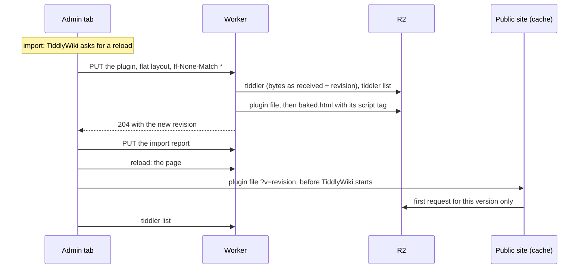

# Plugins as files the page loads

These are the design notes behind [design.md 1.8](design.md#18-plugins-and-javascript-modules): the problem, the design and why it was chosen over baking plugins into the page, what it costs, the change step by step, and how to operate it.

The tests are in `test/plugins.test.mjs`, which runs real plugins shipped with TiddlyWiki, markdown and KaTeX, on the admin site and on a stand-in for the public site (docs/tests.md).

"The external-plugins plugin" below is `$:/plugins/someone/external-plugins`, which exports plugins as standalone `.js` files for single-file wikis. The plugin files here use the same format as its export template.

## Contents

1. [The problem](#1-the-problem)
2. [The design](#2-the-design)
3. [Why it's built this way](#3-why-its-built-this-way)
4. [Cost](#4-cost)
5. [Where it is now](#5-where-it-is-now)
6. [Edge cases and limits](#6-edge-cases-and-limits)

---

## 1. The problem

### How TiddlyWiki starts

When the page loads, TiddlyWiki boots in this order:

1. It reads the tiddlers inside the HTML, then the ones in `$tw.preloadTiddlers`. Scripts that run before TiddlyWiki can add to that list; the worker already uses it for startup tiddlers in `baked.html`.
2. It registers plugins. It reads `$:/config/Plugins/Disabled/<plugin>` at this moment.
3. It defines JavaScript modules (widgets, macros, parsers, startup code), from plugins and from standalone tiddlers.
4. It runs startup modules. One of them starts the sync, which fetches the tiddler list from the worker and then each tiddler.

Anything that arrives in step 4 is too late for steps 2 and 3. Before this change, plugins installed through the wiki arrived in step 4:

| Kind | Before | Why |
|---|---|---|
| Plugin without JavaScript (`plugin-type: plugin`) | Works | TiddlyWiki registers plain plugins live when they arrive. |
| Plugin with JavaScript modules | **Never works** | TiddlyWiki asks you to reload. After the reload the plugin again arrives after boot, so its code never runs, and TiddlyWiki asks again. |
| Theme or language plugin | **Unreliable** | TiddlyWiki only switches when `$:/theme` or `$:/language` changes. If that tiddler arrives before the plugin, the plugin isn't applied in that session. |
| Standalone JavaScript module (`module-type: …`) | **Never works** | Modules are only defined at boot. |
| Disabling a plugin | **Ignored at boot** | The flag arrives after plugins are registered. |

The workaround was to build plugins into `index.html` locally and upload it. That works, but every plugin change needs a local build.

**The constraint:** the public site is R2 behind Cloudflare's cache, and can never use the worker. Whatever loads plugins has to work from files in R2 alone.

---

## 2. The design

- **One file per plugin in R2,** `_plugins/<title>.js`. It's the stored tiddler, untouched, inside the same code the external-plugins export template produces: it adds the tiddler to `$tw.preloadTiddlers`. The stored JSON can go in as it is because JSON is valid JavaScript (since ES2019, even with the U+2028 and U+2029 characters).
- **One `<script>` tag per plugin in `baked.html`,** pointing to the public site: `https://wiki.example.com/_plugins/%24%3A%2Fplugins%2Ftiddlywiki%2Fmarkdown.js?v=1791041234567`. Both sites use this page, so neither loads plugin code through the worker.
- **The browser sends saves in the layout the worker stores:** flat, compact, `text` last. The worker never parses plugin code: it parses only the small part before `"text"`, and appends its revision to the bytes it received.
- **The page build writes the files.** It checks each plugin's file against the tiddler list and rewrites any file that is missing or out of date.
- **The boot choices go into the page too:** `$:/theme`, `$:/language`, `$:/palette` and the plugin disable flags.

What gets a file: tiddlers with `plugin-type` `plugin`, `theme` or `language` (except `$:/core`, which comes with `index.html`, and plugins marked `platform: server`, which only run on a Node.js server and which TiddlyWiki's own tiddler list leaves out too), and modules: tiddlers with a `module-type` whose type is `application/javascript`, `application/json` or `application/x-tiddler-dictionary`, the types TiddlyWiki defines modules from at boot.

### What happens when you drop a plugin on the wiki



**In the browser**

1. **The drop.** TiddlyWiki opens the import dialog. While it waits for you, it holds the plugin in `$:/Import`, which isn't synced while the import is pending.
2. **You click Import.** TiddlyWiki adds `$:/plugins/tiddlywiki/markdown` to its store. `$:/Import` becomes a short import report, an ordinary tiddler that gets saved too.
3. **TiddlyWiki sees a plugin with JavaScript.** It can't activate it without a reload, so it shows "Please save and reload…". The plugin is in the store but not running.
4. **The save is automatic.** About a second later, the conflict guard sends it:
   - `PUT /recipes/default/tiddlers/%24%3A%2Fplugins%2Ftiddlywiki%2Fmarkdown` with `If-None-Match: *` (or `If-Match` for an update) and `X-Tiddler-Layout: flat`;
   - the body has every field at the top level, `text` last, and no `revision`, `bag` or `recipe`:

   ```json
   {"title":"$:/plugins/tiddlywiki/markdown","type":"application/json","plugin-type":"plugin","version":"5.4.1","list":"readme usage","text":"{\"tiddlers\":{…}}"}
   ```

**In the worker: one request**

5. **It reads the body as bytes** and finds the first `,"text":`. It parses only what comes before: the fields, a few hundred bytes.
6. **It checks for a conflict:** the stored revision against `If-Match` / `If-None-Match`, as before.
7. **It appends `,"revision":"1791041234567","bag":"default","recipe":"default"`** before the final `}` and writes the result to `recipes/default/tiddlers/$:/plugins/tiddlywiki/markdown`, with `layout: flat` in its metadata. The text is copied as bytes, never decoded.
8. **It queues the GitHub backup,** as before.
9. **It updates the tiddler list** with the plugin's entry (all fields but `text`), and gets back the entry it replaced. Only then does it purge the tiddler's public URLs and the list's, so a public request in between can't put the old list back in the cache. Plugin files are never purged.
10. **The plugin is something the page needs at boot, so it rebuilds `baked.html` before answering.** The page build:
    - reads `index.html`, the tiddler list and the startup tiddlers, as before;
    - checks each plugin's file with a `HEAD`. This one is missing or has an older revision, so it reads the stored tiddler and writes `_plugins/$:/plugins/tiddlywiki/markdown.js`: the opening of the template, the stored bytes, the closing;
    - inserts the preload script and one `<script src>` per plugin after `<head>`, working on the bytes of `index.html` (since the admin wiki publishes the page, [design 1.9](design.md#19-the-page-published-from-the-admin-wiki), usually the published shell instead, where the plugin tags go right before the core file's `<script>`);
    - saves `baked.html` and purges `/` and `/baked.html` on the public site.
11. **It answers `204`** with the new revision in the `ETag`.

Steps 9 and 10 run under `ctx.waitUntil` as well as being awaited, so they finish even if the browser goes away first, for example when you reload while the page is being built.

The import report is a second, small save that goes through steps 5–9 and 11.

**After you reload**

12. **The page:** the worker serves the new `baked.html`.
13. **The plugin file:** the browser fetches it from the public site, not the worker. The new `?v=` misses Cloudflare's cache once, so it's read from R2; after that both Cloudflare and the browser keep it.
14. **It runs before TiddlyWiki boots** and adds the plugin to `$tw.preloadTiddlers`. TiddlyWiki registers it and defines its modules.
15. **No reload loop.** The sync gets the tiddler list and finds the same revision for the plugin as the one in the file, so it doesn't download it again.

The worker sees two requests on that load: the page and the tiddler list. (Three when this change was made; since then the browser keeps `/status` for a week, [design 1.5](design.md#15-keeping-worker-requests-down).) The public site serves the same `baked.html`, so visitors get the plugin too.

---

## 3. Why it's built this way

### 3.1 Files, not plugins baked into the page

The earlier plan put every plugin inside `baked.html`:
- **The page would grow** with each plugin, easily by a megabyte or more, and both sites would download all of it again whenever anything in the page changed.
- **Each rebuild would read and re-serialize every plugin,** which doesn't fit in 10 ms of CPU.

With files, the page grows by one line per plugin, each plugin is cached on its own, and the rebuild never parses plugin code: it only copies a plugin's stored bytes when that plugin's file needs rewriting (and, for a plugin stored by another tool without the worker's metadata, reads it once to find its revision).

The external-plugins plugin does the same for a single-file wiki, where you export and upload each file by hand. Here the worker already receives every plugin when it's saved, so it writes the file itself.

### 3.2 Loaded from the public site, even by the admin page

A relative URL (`/_plugins/…`) would make the admin page load plugins through the worker. Browsers would still cache them, since the worker passes the files' cache headers on, but every browser would cost one worker request per plugin version, every hard reload would cost more, and Cloudflare never caches what a worker generates, so there'd be no shared cache. The public URL costs no worker request on either site. A `<script src>` from another hostname needs no CORS header.

The trade-off: the admin page now depends on the public site being up to load its plugins. It already uses the public site for tiddler contents, but those fall back to the worker; plugin files don't.

### 3.3 A stable name, `?v=<revision>` in the URL

- **The name is the title,** URL-encoded the same way as the tiddler URLs the public wiki already loads. Titles are unique, so no hash is needed.
- **`?v=` is the revision,** which is the save time in milliseconds. Every version gets a new URL, so Cloudflare and browsers can keep each file for a year (`Cache-Control: public, max-age=31536000, immutable`), and nothing ever needs purging.
- **Not per-version file names:** they'd pile up in R2 and need cleaning.
- **Not purging:** a purge makes the next visitor's request read from R2 again (a Class B operation), and needs an exact URL anyway.

R2 ignores the query string when it looks up the file.

### 3.4 One tag per plugin, not a loader

A single loader script that adds the others would have to insert them dynamically, and dynamically added scripts run after TiddlyWiki has booted (`document.write` would work but is fragile). It would also add a round trip before any plugin starts loading. With the tags in the HTML, the browser finds them all at once and fetches them in parallel.

### 3.5 The browser sends the layout the worker stores

Before this change, every save was parsed and re-serialized by the worker, just to add `revision`, `bag` and `recipe`. For plugins that's a lot of CPU:

| Plugin | Size | TiddlyWeb layout (before) | Flat layout |
|---|---|---|---|
| markdown | 240 KB | 2.6 ms | 0.1 ms |
| KaTeX | 735 KB | 6.5 ms | 0.3 ms |
| geospatial | 945 KB | 10 ms | 0.4 ms |

Median CPU of the body handling, measured in Node.js (the same JavaScript engine as Workers) on a slow, shared 2-core test machine, so only the proportions matter. The flat column includes building the plugin file.

**Why cutting at `,"text":` is safe:** inside a JSON string every quote is escaped as `\"`, so the sequence `,"text":` can only be the `text` key itself. The flat layout has no nested objects except that one, `{"fields":"…"}`, which holds no `"text"` key, and the browser puts `text` last. In UTF-8, bytes of multi-byte characters are never ASCII, so searching the bytes can't match inside one either.

**The worker's fields come last.** It appends `revision`, `bag` and `recipe` to the end of the body, so even if a client sent its own `revision`, the worker's wins: JSON readers keep the last value of a repeated key.

**Compatibility:**
- Saves in any other layout are parsed and turned into the flat one: saves without the `X-Tiddler-Layout: flat` header (tabs opened before the deploy, or with the module off, which use TiddlyWeb's layout), and bodies sent with the header that don't follow the layout (pretty-printed, with `text`, `revision`, `bag` or `recipe` among the fields before `"text"`, or with a value that isn't text). A body that isn't a tiddler is refused with `400`. The one thing the worker can't check cheaply is fields placed *after* `text`: they're stored, but missing from the tiddler list. The browser module never does that.
- A field literally called `fields` is the one exception to the flat layout: it's sent and stored nested, as `"fields":{"fields":"…"}`, the way TiddlyWeb's layout has it, because a flat `fields` is where TiddlyWiki's loader looks for nested custom fields. TiddlyWiki unpacks it only for tiddlers loaded through sync, so the page build unpacks it in baked startup tiddlers and plugin files. A field value that's an object can't be stored (a `"text"` key inside it would be taken for the text) and is refused with `400`; TiddlyWiki never sends one.

At first, other layouts were stored as they came, so the bucket held both and every reader handled both. A later change made the flat layout the only one stored, which removed that code throughout the worker; a bucket filled before then had to be converted once, with a script since removed.

**Alternatives considered:** flattening in the worker would have added about half again to the save's CPU, which is why the browser sends the flat layout; the worker flattens only the rare saves that arrive in another one. Flattening in the plugin file (one extra line in the browser) costs nothing there, but leaves the save's own parse and re-serialize.

### 3.6 The page build is the only writer of plugin files

- **One place** that decides what a file contains.
- **It repairs itself:** a missing or outdated file is rewritten on the next build. That also covers the first load after deploying, for plugins already in the wiki.
- **The cost:** one `HEAD` per plugin per build, and one read of the stored tiddler when its file is rewritten. Builds only happen when something the page needs at boot changes, and on the first admin page load after a deploy or a new `index.html`.

**Overlapping builds don't go backwards.** Two builds can run at once: two tabs saving, or a save during the first load after a deploy. Without care, the slower one could write an older version last. That would be bad for a file in particular: the page could ask for `?v=r2` while R2 holds r1, and Cloudflare would cache r1 under that URL for a year. So:
- **A file** is written only if it's still the one the build looked at (`etagMatches`, or create-only if it was missing), and not replaced by one holding a newer revision. If another build got there first, the tag uses the revision the file holds.
- **The page:** each `baked.html` records when the tiddler list it was built from was stored in R2 (`listVersion`, R2's own upload time). A build doesn't replace a page built from a newer list for the same worker and `index.html`. Using R2's time rather than a counter of the worker's own means a list replaced by hand counts as newer too, instead of freezing the page.
- **Best effort:** each of these tries three times, and the last try writes without a condition, like the create-only fallback in the save handler (a create-only write can be refused even though nothing is there). Losing two races in a row is very unlikely with one person editing.

### 3.7 The page is built from bytes

`index.html` is a few MB. On the test machine (a slow, shared 2-core server), decoding the 2.6 MB test wiki into a string, inserting the script and encoding it back took about 16 ms of CPU. Working on the bytes, and only decoding the first 16 KB to find `<head>`, took about 1.6 ms. (In a published shell, plugin tags go before the core file's `<script>`, found by decoding the page's last 64 KB the same way.) Cloudflare's servers are faster, so both numbers are lower there, but the ratio holds. Decoding that start of the file keeps a byte order mark, if there is one, so the insertion point stays exact.

### 3.8 Disabled plugins keep their tag

Leaving a disabled plugin out of the page would make the sync fetch it after boot. TiddlyWiki then asks for a reload for any plugin with JavaScript that arrives after boot, disabled or not (`$:/core/modules/startup/plugins.js`), so it would ask on every load. Instead, the disable flag goes into the page, so TiddlyWiki skips the plugin at boot. The Control Panel still lists it, so it can be enabled again. The cost is one cached download.

### 3.9 Theme, language and palette choices are in the page

With the theme plugin present at boot, `$:/theme` has to be there too. Otherwise TiddlyWiki starts with the default theme and only switches when `$:/theme` arrives through sync, which shows the wrong theme for a moment. The same goes for `$:/language` and `$:/palette`.

### 3.10 No switch in the worker

A plugin that breaks the page is fixed by deleting its file ([operating 3.6](operating.md#36-if-a-plugin-breaks-the-page)). TiddlyWiki's safe mode isn't an option: it also turns off the TiddlyWeb plugin, so nothing could be saved back, and TiddlyWiki warns against it in client-server setups.

### 3.11 The TiddlyWeb plugin is treated like any other

If it were excluded, updating it from the plugin library would store the new version, which the sync would then fetch after boot on every load: TiddlyWiki would ask for a reload every time, and the update would never run. Included, the update runs at boot like any plugin. The conflict guard modifies whichever version loads. After such an update, run the two-tab test against your new version (section 6).

---

## 4. Cost

**CPU per request** (Workers Free allows 10 ms, with some flexibility for occasional overruns):

| Request | Before | After |
|---|---|---|
| Saving a 945 KB plugin | about 10 ms for the body alone | about 0.4 ms for the body, plus about 2 ms for the page build |
| Saving an ordinary tiddler | small | the same, slightly less |
| Any save | the tiddler list: about 1 ms per 400–500 tiddlers | the same; after a plugin save, the page build reuses the list the save wrote |

These figures come from the same test machine as in section 3, so read them as proportions. The worker's metrics in the Cloudflare dashboard show its real CPU time per request.

**The backup queue consumer** spends about 1 ms of CPU on a 254 KB plugin, measured on the test machine (git's blob hash, and the base64 written straight into the request's bytes; GitHub's copy of the previous version isn't decoded, which took about 14 ms more). Queue consumers share the Workers per-invocation CPU limits ([Queues limits](https://developers.cloudflare.com/queues/platform/limits/)), so on the Free plan count on 10 ms, with some tolerance for occasional overruns. A run stops taking versions once it has handled 512 KB, so a batch of several plugin updates is spread over several runs ([design 1.7](design.md#17-github-backup)). The fallback without a queue runs inside the save request, so keep the queue bound.

**Worker requests:** unchanged by this change: plugin files never reach the worker. (A page load was three requests, and is two since the browser keeps `/status` for a week, [design 1.5](design.md#15-keeping-worker-requests-down).)

**Per plugin save:**
- **R2 writes (Class A):** the tiddler, the tiddler list, the plugin file, `baked.html`, plus the backup copy for a version too big for a queue message (about 64 KB of text, [design 1.7](design.md#17-github-backup)).
- **R2 reads (Class B):** nine with a published shell (ten before the first publish, when the page is built from `index.html`), plus one `HEAD` per other plugin and one read per listed startup tiddler for the page build.
- **Subrequests:** all of the above, plus the queue message, count against the Free plan's 1,000 calls to Cloudflare services per request; only the purges count against its 50 external ones.
- **Purges:** the tiddler's URLs and the two page URLs, as for any page change. Never plugin files.

**Saving a boot choice** (`$:/theme`, a disable flag, a startup action) costs the same page build, without rewriting files. Ordinary saves are unchanged.

**Visitors** download each plugin once per version. Cloudflare compresses JavaScript, so a 1 MB plugin travels as a few hundred KB.

---

## 5. Where it is now

- **The code:** `src/worker/plugins.js` (the files), `src/worker/build.js` (the page build, which writes them and puts the `<script>` tags in), `src/worker/layout.js` (the flat layout a save arrives in and is stored in), `src/worker/saves.js` (a plugin's save or delete rebuilding the page), and in `src/browser/conflict-guard.js` the part that sends saves in the flat layout.
- **The tests:** `test/plugins.test.mjs`, and the plugin cases of `test/integrity.test.mjs` and `test/r2-ops.test.mjs` (docs/tests.md).
- **The cache rule for plugin files:** [setup 2.7](setup.md#27-the-zones-rules-public-site-only).
- **A plugin that breaks the page:** [operating 3.6](operating.md#36-if-a-plugin-breaks-the-page).

## 6. Edge cases and limits

- **A plugin also built into `index.html`:** the file wins, because preloaded tiddlers are added after the HTML's own. So updating such a plugin from the library works. The other way round, after uploading an `index.html` with a newer version, the stored copy still wins; delete it in the wiki to use the one in `index.html`.
- **Updating the TiddlyWeb plugin from the library:** the conflict guard modifies some of its functions (saving, loading, deleting, the tiddler list). After an update, download `index.html`, add the new plugin to a copy and run `WIKI_HTML=… npm run test:tabs`, or simply watch for conflict alerts working as before. (Since the page is published from the admin wiki, [design 1.9](design.md#19-the-page-published-from-the-admin-wiki), an installed TiddlyWeb also stops publishing: the worker refuses a page without TiddlyWeb, and says what to do. Upgrading TiddlyWiki with a new `index.html` brings a matching TiddlyWeb instead.)
- **`$:/core`** never gets a file: it isn't synced. Upgrade TiddlyWiki by uploading a new `index.html`.
- **An old page loading new code:** a page cached somewhere with an old `?v=` could fetch a file that has since been overwritten, once that old URL has left Cloudflare's cache. It then simply runs the new version, which matches the tiddler list.
- **Leftover files:** a file can outlive its plugin if two builds overlap at the moment the plugin is turned into an ordinary tiddler. Nothing loads it; delete it in R2 if you notice it.
- **Browsers:** the file uses `??=` and `??`, like the external-plugins template, so it needs a browser from 2020 or later.
- **`$:/tags/RawMarkup…` tiddlers inside an installed plugin:** the admin wiki renders the page ([design 1.9](design.md#19-the-page-published-from-the-admin-wiki)) with that plugin in it as well as in its file, so its markup is there; for a plugin with JavaScript, from the first admin load after installing it.
- **Plugin files are public,** like everything in the bucket. A deleted plugin's file is removed from R2 but not purged, so its old `?v=` URL stays reachable in Cloudflare's cache until it expires; nothing loads it.
- **Very large plugins:** a save holds a few copies of the body in memory, well within the 128 MB a worker has, and well under the 100 MB request size limit.
- **The tiddler list** is still read and rewritten on every save. It's now the largest CPU cost of a save: about 1 ms per 400–500 tiddlers.
